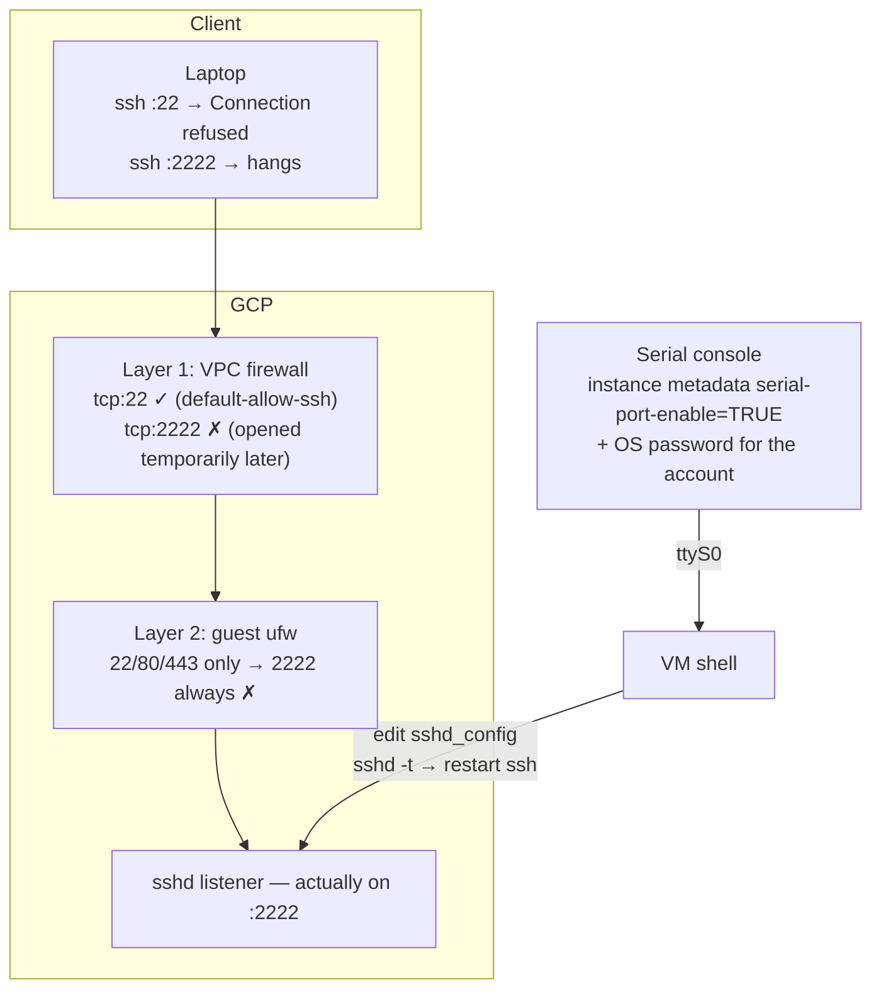

# 01 — SSH Lockout Rescue via Serial Console

**Goal:** deliberately lock myself out of SSH by moving `sshd` to a non-standard port, then recover the box without any working SSH access — using only the GCP serial console.

This is a practice lab, not a production incident, but every step was performed on a real Compute Engine VM.

## Environment

| Item | Value |
|------|-------|
| Instance | `practice-web`, e2-micro |
| Zone | `us-central1-a` |
| Image | Debian 12 (`debian-12`) |
| Boot disk | 20 GB pd-standard |
| VPC firewall | `default-allow-ssh` (tcp:22), `allow-http` (tcp:80,443, tag `http-server`) |
| Guest firewall | ufw — only 22/80/443 allowed |
| sshd | OpenSSH, config at `/etc/ssh/sshd_config` |

## Architecture / failure model

Two firewall layers sit between the laptop and `sshd`, plus the serial console as an out-of-band path:



## Timeline (from the VM journal, UTC)

Full excerpt in [evidence/timeline-excerpt.txt](evidence/timeline-excerpt.txt). Key moments:

| Time (UTC) | Event |
|---|---|
| 01:40:31 | Hardening: `PasswordAuthentication no` applied |
| 01:56:51 | **The break** — `vi /etc/ssh/sshd_config`, added `Port 2222` |
| 01:57:51 | sshd restarts: `Server listening on 0.0.0.0 port 2222` — 22 no longer served |
| 01:58:24 | Last normal SSH session disconnects |
| 02:25:15 | Serial console session established (OS password login) |
| 02:51–03:00 | Serial-console diagnostics: `sshd -T`, `grep Port` on config and drop-ins |
| 03:02–03:03 | First edit + restart — **still bound to 2222**; verification after restart caught it |
| 03:06–03:07 | Back to `grep` to re-locate the active directive |
| 03:08:40 | Second edit — `sshd -t` passes |
| 03:08:47 | Fixed: `Server listening on 0.0.0.0 port 22` |
| 03:09:26 | SSH session restored |

Total time from break to fix: ~71 minutes. Time from serial-console access to fixed service: ~43 minutes. Note the first edit round did **not** change the effective port — only re-checking after the restart revealed the directive was still active.

## The symptoms, and why they differ

- **Port 22 → `Connection refused`.** The packet reached the host and got a TCP RST — the VPC firewall allowed 22, but nothing was listening there anymore.
- **Port 2222 → hang, no output.** The packet was dropped before reaching the host — the VPC firewall had no rule for 2222 at that moment.

Refused = nothing listening (service layer). Hang = packet filtered (firewall layer). That distinction alone narrows the search a lot.

## First fix attempt — and why it failed

I opened `tcp:2222` in the VPC firewall:

```bash
gcloud compute firewall-rules create allow-ssh-2222 \
  --allow=tcp:2222 --target-tags=http-server
```

Still unreachable. **Root cause: the guest OS firewall (ufw) only allowed 22/80/443** — the VPC rule opened the outer layer, but the inner layer kept dropping 2222. Two firewalls, one opened.

Evidence is right in the kernel log:

```
[UFW BLOCK] ... SRC=82.147.85.103 DST=10.128.0.3 ... PROTO=TCP ... DPT=3389 ... SYN
```

## Recovery via serial console

**Prerequisites (set up while SSH still worked — this is the whole lesson):**

1. Instance metadata `serial-port-enable=TRUE`
2. An OS-level password for the login account (`sudo passwd <user>`), because the serial console logs in through the local tty, not sshd

**Steps:**

```bash
# From the laptop
gcloud compute connect-to-serial-port practice-web --zone=us-central1-a

# Inside the serial session
sudo systemctl status ssh --no-pager -n 5     # service alive, listening on 2222
sudo sshd -T | grep -i '^port'                # effective port = 2222
sudo grep -rn -i 'port' /etc/ssh/sshd_config /etc/ssh/sshd_config.d/
#   → /etc/ssh/sshd_config:14:#Port 22   (commented default)
#   → /etc/ssh/sshd_config:58:Port 2222  (the override)

sudo vi /etc/ssh/sshd_config                  # remove the Port 2222 line
sudo sshd -t                                  # validate config BEFORE restarting
sudo systemctl restart ssh
sudo sshd -T | grep -i '^port'                # → port 22
sudo systemctl status ssh -n 3 --no-pager     # listening on 0.0.0.0 port 22

# Back on the laptop — verify, then clean up the temporary rule
ssh -i ~/.ssh/google_compute_engine <user>@<public-ip>
gcloud compute firewall-rules delete allow-ssh-2222
```

**Final state:** no active `Port` directive remains in `sshd_config` (only the commented `#Port 22` default), so sshd binds to 22.

## Root causes

1. **sshd config precedence**: sshd_config takes the *first* active value for a keyword; `Include /etc/ssh/sshd_config.d/*.conf` at the top of the file means drop-ins win over the body. Here the default on line 14 was commented out, so the only active `Port` directive was line 58 — my override — and it applied.
2. **Layered firewalls**: a VPC firewall rule is not an OS firewall rule. Opening one layer says nothing about the other.
3. **Security side note**: the journal is full of background noise — `UFW BLOCK ... DPT=3389` (RDP scans) and `Invalid user telecomadmin/user` attempts within minutes of the VM getting a public IP. Public SSH is scanned constantly. That is why password auth is disabled, and why a non-default port is not a security control by itself.

## Lessons learned

- Always confirm the serial console works **before** touching sshd config — a rescue path you've never tested is not a rescue path.
- Validate with `sshd -t` before `systemctl restart ssh`; a syntax error in the config turns a small change into a lockout.
- When SSH misbehaves, separate the two questions: "is sshd listening?" (`sshd -T`, `systemctl status`) and "is the packet allowed through?" (`ufw status`, VPC rules, `[UFW BLOCK]` lines).

## Evidence

- [evidence/timeline-excerpt.txt](evidence/timeline-excerpt.txt) — sanitized journal excerpt (emails and my own connecting IP redacted; third-party scanner IPs kept as-is)
- Screenshots: `screenshots/mac-connection-refused.png`, `screenshots/serial-console-session.png` *(to be added)*

## Cost notes

e2-micro in `us-central1` — covered by the Always Free tier. Instance torn down after the lab.
