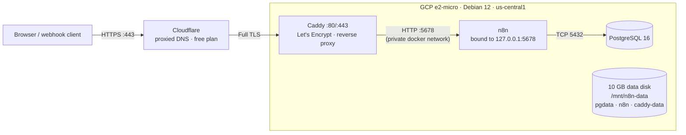

# 02 — Self-Hosted n8n on Google Cloud

**Compute Engine · Docker Compose · PostgreSQL 16 · Caddy (automatic TLS) · Cloudflare**

## What it is

A production-shaped, single-node deployment of [n8n](https://n8n.io) on a GCP `e2-micro` instance: public HTTPS endpoint, PostgreSQL persistence on a dedicated data disk, automatic Let's Encrypt certificates via Caddy, and the whole stack running behind Cloudflare.

The goal was not just "n8n answers on port 443" — it was to build it the way a small client deployment would be built: state on a disk that survives VM rebuilds, containers that come back by themselves after a reboot, TLS that renews itself, and a chain of diagnostics I can explain for every layer.

**Live demo:** https://n8n-gcp.cloudworkflowdone.com

Verified end-to-end with a live webhook workflow and a reboot-persistence test (details below).

## Architecture



| Layer | Choice | Why |
|---|---|---|
| Compute | `e2-micro`, Debian 12, `us-central1-a` | Always Free tier; one shared vCPU is enough for a single n8n instance |
| Disk | 20 GB boot + **10 GB pd-standard**, mounted at `/mnt/n8n-data` via **UUID** in `/etc/fstab` | All state lives on the data disk; the VM can be thrown away and rebuilt |
| Orchestration | Docker Compose: `n8n` + `postgres:16` + `caddy:2` | Small, explicit, easy to reason about — no orchestrator tax for a single node |
| TLS | Caddy + Let's Encrypt (HTTP-01) | Zero-config renewal; certificates stored on the data disk |
| Edge | Cloudflare (proxied DNS) | Free CDN/DDoS layer; also hides the origin IP |

Key configuration decisions:

- **n8n never faces the internet directly.** Its port is published as `127.0.0.1:5678`, so only Caddy can reach it. External exposure is Caddy's job alone.
- **`N8N_DEFAULT_BINARY_DATA_MODE=filesystem`** — binary payloads from webhooks go to the mounted volume instead of bloating PostgreSQL.
- **`N8N_PROXY_HOPS=2`** — there are exactly two proxies in front of n8n (Cloudflare, then Caddy), so it must trust `X-Forwarded-For` for rate limiting to behave.
- **`depends_on: postgres: condition: service_healthy`** — n8n waits for the DB healthcheck, not just container start, to avoid a crash on the first boot.
- **`restart: unless-stopped`** on all three services — the reboot test later proves this works.

## How to reproduce

This directory contains everything needed: `docker-compose.yml`, `Caddyfile`, `.env.example`.

1. **Data disk + Docker** on the VM (Debian 12): attach a 10 GB disk, `mkfs.ext4`, mount it by UUID at `/mnt/n8n-data` (never by device name — attach order changes), install Docker CE + Compose plugin.

2. **Secrets**: `cp .env.example .env`, then fill in a strong `POSTGRES_PASSWORD` and `openssl rand -hex 24` for `N8N_ENCRYPTION_KEY`. The encryption key is permanent — losing it means every stored credential becomes undecryptable.

3. **Bring the stack up**: `docker compose up -d`. Wait for `postgres` healthy, then `n8n`, then `caddy`.

4. **Network layers — all three of them**:
   - VPC firewall rules for tcp:80/tcp:443 (GCP blocks everything by default);
   - `ufw` on the host for the same ports;
   - DNS A record `n8n-gcp` → VM public IP (proxied through Cloudflare in my case).

5. **Certificate**: Caddy obtains it automatically once DNS resolves and port 80 is reachable for the HTTP-01 challenge. Watch `docker compose logs caddy` for `certificate obtained successfully`.

## Verification

The acceptance test was a minimal workflow — **Webhook → Code → Respond to Webhook** — called over the public HTTPS endpoint:

```bash
$ curl -X POST https://n8n-gcp.cloudworkflowdone.com/webhook/demo \
    -H 'Content-Type: application/json' \
    -d '{"name":"lukecheng"}'
[{"status":"ok","service":"n8n-on-gcp","message":"hello from practice-web",
  "received":{"name":"lukecheng"}}]
```

Then the persistence test: `sudo reboot` → all three containers back up by themselves (~2 min on the free-tier VM), data disk auto-mounted, and the same curl returned the identical payload. The workflow, database, credentials, and TLS certificates all survived a cold boot.

## What broke — and how I fixed it

The interesting part. Every item below actually happened during the build, in this order.

**1. Caddy couldn't bind port 80.** A leftover nginx from an earlier exercise held `0.0.0.0:80`. `ss -tlnp` showed the PID → `systemctl stop nginx && systemctl disable nginx`. Lesson: always check who owns a port before blaming the new service.

**2. Container DNS was broken on GCP.** Caddy could not reach Let's Encrypt: `lookup acme-v02.api.letsencrypt.org on 169.254.169.254:53: connect: network is unreachable`. The host resolved fine — the pull had just worked — but `169.254.169.254` is GCP's metadata/DNS address, and it is **not routable from inside a Docker network namespace**. Fix: explicit `"dns": ["8.8.8.8","8.8.4.4"]` in `/etc/docker/daemon.json`. Containers receive DNS config at creation time, so a `docker compose down && up` was required, not just a Docker restart.

**3. n8n crash-looped with `EACCES: permission denied, open '/home/node/.n8n/config'`.** The bind-mount directory was auto-created by Docker as `root:root`, but the n8n image runs as `node` (UID 1000) and does not chown its state directory. Fix: `chown -R 1000:1000 /mnt/n8n-data/n8n`. (PostgreSQL was unaffected — its official entrypoint chowns its own data directory when started as root.)

**4. Break-fix drill: a wrong database password.** I deliberately changed `POSTGRES_PASSWORD` in `.env` to a wrong value. n8n went into `password authentication failed for user "n8n"` while `docker compose ps` still showed `postgres healthy`. The server-side logs sealed the diagnosis — `FATAL: password authentication failed` with `DETAIL: Connection matched ... pg_hba.conf ... scram-sha-256` — proving the DB itself was healthy and the connection reached it; only the credential was wrong. Key takeaway: **`POSTGRES_PASSWORD` only takes effect when the data directory is first initialized**; afterwards the real password must be changed with `ALTER USER n8n WITH PASSWORD '...'`, and `.env` updated to match.

**5. Break-fix drill: storage without a bind mount.** With the stack running and a workflow created, I removed the PostgreSQL bind mount (`volumes: []`), ran `docker compose down && up -d` — and n8n asked to set up the owner account again. The `postgres` image declares `VOLUME /var/lib/postgresql/data`, so Docker created a **new anonymous volume** and initialized a fresh, empty database: the owner, workflows and credentials were gone from the application's point of view. Repeating `down/up` produced yet another empty anonymous volume — data "loss" on every cycle. `docker volume ls -f dangling=true` showed the orphaned volumes; restoring the bind mount and recreating the containers brought the original account and workflows back intact. The takeaway: **container lifecycle ≠ data lifecycle** — anonymous volumes die with their containers (leaving dangling orphans), while the bind-mounted host directory at `/mnt/n8n-data/pgdata` was never touched.

**6. `ERR_ERL_UNEXPECTED_X_FORWARDED_FOR` in the n8n logs.** After recovery, express-rate-limit rejected requests carrying `X-Forwarded-For`: n8n didn't trust any proxy headers (`N8N_PROXY_HOPS=0` by default), while my chain has two proxies. Fix: `N8N_PROXY_HOPS=2`. This one is specific to multi-proxy architectures — a single-Caddy setup would never surface it.

**7. Cloudflare made `dig` look "wrong".** `dig +short` returned Cloudflare edge IPs, not the VM IP, which looked like a misconfigured DNS record. It wasn't — the record is proxied. The correct verification slays the doubt:

```bash
# edge (goes through Cloudflare)
curl -sI https://n8n-gcp.cloudworkflowdone.com | grep -iE 'server|cf-ray'
# → server: cloudflare, cf-ray: ...

# origin (bypasses Cloudflare, must return 200 from Caddy)
curl -skI --resolve n8n-gcp.cloudworkflowdone.com:443:<VM_IP> \
  https://n8n-gcp.cloudworkflowdone.com
```

Also worth knowing: the n8n registry (`docker.n8n.io`) has no CDN and took **634 s** to pull a single image; `docker.io/n8nio/n8n` is the faster equivalent.

**8. Break-fix drill: breaking TLS on purpose — and tripping over an even better bug.** The plan was to add `tls internal` to the Caddyfile so Caddy self-signs instead of asking Let's Encrypt. The first attempt "failed" in a revealing way: `curl` still said `verify ok`, the issuer was still Let's Encrypt, and the Caddy log said `config is unchanged`. Root cause: `sed -i` edits by **rename** (a new inode), but `./Caddyfile:/etc/caddy/Caddyfile` is a **single-file bind mount** pinned to the old inode — `cat -A` on the host showed `tls internal`, while the container kept reading the stale file. When a config change "doesn't take," the logs tell you the container never saw it. After `docker compose restart caddy` re-bound the mount, the self-signed cert took effect: direct `curl --resolve` returned `curl: (60) unable to get local issuer certificate`, and `openssl s_client` showed the issuer flip from `Let's Encrypt` to `Caddy Local Authority - ECC Intermediate`. Then the CDN taught the second lesson — through Cloudflare **Full** the site still answered 200 (the proxy doesn't validate the origin cert), but **Full (strict)** surfaced it as **526 Invalid SSL certificate**; same origin, two different stories, which is why the origin must be tested directly. Rollback was `cp Caddyfile.bak Caddyfile` (an in-place write — no inode change) + `restart`; a brief **521** while Caddy dropped the port, then the original Let's Encrypt cert (`cert_hash 2161b84d…`) came straight back from `/mnt/n8n-data/caddy-data` — untouched the whole time. Full walkthrough in [`caddy-tls-breakfix.md`](caddy-tls-breakfix.md).

## Cost notes

Everything here fits in GCP's Always Free tier: one `e2-micro` in `us-central1`, total disk 30 GB (20 GB boot + 10 GB data — exactly at the free ceiling), Caddy and Let's Encrypt cost nothing, Cloudflare free plan. Idle cost ≈ $0. The VM stays within these limits by design; no premium services were used.

## Timeline

See [`timeline.md`](timeline.md) for the sanitized deployment log (UTC timestamps).
