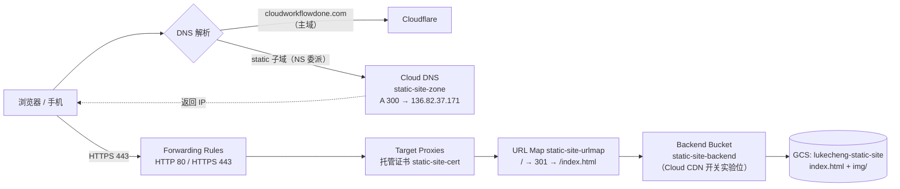

# 练习 3 · 静态站：GCS + 全局 HTTPS LB + Cloud DNS 子域委派

用 Cloud Storage 托一个静态站，前面挂全局负载均衡和 Google 托管证书，子域从 Cloudflare 委派给 Cloud DNS。搭好之后做了三轮"故意搞坏 → 定位 → 修复"演练。

## 架构



## 搭建过程

逐步命令、每步验证、四个踩坑（`.DS_Store` 上传、403 vs ListBucketResult、`/` 404 需 urlRedirect、证书 PROVISIONING→ACTIVE 等待），全部在 **[handbook.html](handbook.html)**。

## 三轮破坏-修复演练

| # | 破坏什么 | 故障指纹 | 修复 | 文档 |
|---|---------|---------|------|------|
| 1 | 撤掉 bucket 的 `allUsers objectViewer`（存储桶变私有） | 新请求 403，但被边缘缓存掩护（老缓存还吐 200）；手机无缓存直现 AccessDenied | 重新授予 objectViewer | 记录在 handbook 验证章节 |
| 2 | 开/关 Cloud CDN，追查 `age:` 头到底是谁给的 | `age:` 在 CDN 关闭后依然存在 | 无需修复（本来就没坏）——定性结论 | **[cdn-breakfix.md](cdn-breakfix.md)** |
| 3 | Cloud DNS A 记录指到 `192.0.2.1`（不可路由黑洞） | 连接超时（不是 5xx）；Cloudflare 面板无感知；`--resolve` 绕过 DNS 依然 200 | 事务回滚 A 记录 | **[dns-breakfix.md](dns-breakfix.md)** |

## 核心教训（三轮演练沉淀）

1. **`age:` ≠ Cloud CDN。** 它来自 GCS 自己的全球边缘缓存。判定 CDN 只看 `X-Cache` 和 `Via: 1.1 google`。
2. **DNS 类故障指纹是"超时/NXDOMAIN"，不是 5xx。** 导航指错车到不了店；服务本身、证书都无恙。
3. **判断 DNS 生效看权威 NS**（字母必须对上自己 zone 的 c1–c4 编号）；本地 resolver 有 TTL 300 缓存，别拿缓存当真相——没真正生效就下结论会自己绕进去。
4. **`curl --resolve` 绕过 DNS**（测 DNS 故障别带它）；**shell 有 `http_proxy` 时 `--resolve` 还会被代理无视**，必须配 `--noproxy '*'`。
5. **缓存会掩护故障。** 撤权限后老缓存照样 200，手机（无缓存）才见真面目。验证要穿透缓存或换新对象。
6. 跳板机 squid 的 `X-Cache: MISS from ...`（带 from 后缀）与 Cloud CDN 的裸 `X-Cache: HIT` 同名不同源，抓头时先分清路径里有谁。

## 资源清单（project: lukechengtest）

> **环境状态（2026-11-04）**：演练收尾，按方案 B 拆除了 LB 五件套（转发规则 ×2、代理 ×2、URL map）+ backend bucket 资源 + 托管证书 + 静态 IP，并删除指向已释放 IP 的悬空 A 记录。**保留**：`gs://lukecheng-static-site` 存储桶、Cloud DNS zone `static-site-zone`（SOA/NS 仍在，Cloudflare 的 NS 委派不动）。后续练习（见 [ROADMAP.md](../ROADMAP.md)）需要重建本套环境时，从 handbook 的 LB 段开始，静态 IP 可能变化、证书需重新走 PROVISIONING（约 30–60 分钟）。

| 资源 | 名称 / 值 |
|------|-----------|
| Bucket | `gs://lukecheng-static-site` |
| Backend bucket | `static-site-backend` |
| URL map | `static-site-urlmap`（含 `/` → 301 `/index.html`） |
| Target proxies | `static-site-http-proxy` / `static-site-https-proxy` |
| Forwarding rules | `static-site-http-rule`(80) / `static-site-https-rule`(443) |
| 静态 IP | `static-site-ip` = 136.82.37.171（全局） |
| 托管证书 | `static-site-cert`（static.cloudworkflowdone.com） |
| Cloud DNS zone | `static-site-zone`（ns-cloud-c1..c4.googledomains.com） |
| 域名 | `static.cloudworkflowdone.com`，主域 NS 在 Cloudflare |

## 清理命令（演练结束后释放资源）

```bash
PROJECT=lukechengtest

# LB 五件套 + 证书 + IP
gcloud compute forwarding-rules delete static-site-http-rule static-site-https-rule \
  --global --quiet --project=$PROJECT
gcloud compute target-http-proxies delete static-site-http-proxy --quiet --project=$PROJECT
gcloud compute target-https-proxies delete static-site-https-proxy --quiet --project=$PROJECT
gcloud compute url-maps delete static-site-urlmap --global --quiet --project=$PROJECT
gcloud compute backend-buckets delete static-site-backend --quiet --project=$PROJECT
gcloud compute ssl-certificates delete static-site-cert --global --quiet --project=$PROJECT
gcloud compute addresses delete static-site-ip --global --quiet --project=$PROJECT

# DNS：先删 A 记录才能删 zone（注意：delete 不认 --ttl；Cloudflare 侧 NS 委派去面板删）
gcloud dns record-sets delete static.cloudworkflowdone.com. \
  --zone=static-site-zone --type=A --quiet --project=$PROJECT
gcloud dns managed-zones delete static-site-zone --quiet --project=$PROJECT

# 存储桶
gcloud storage rm --recursive gs://lukecheng-static-site --project=$PROJECT
```
