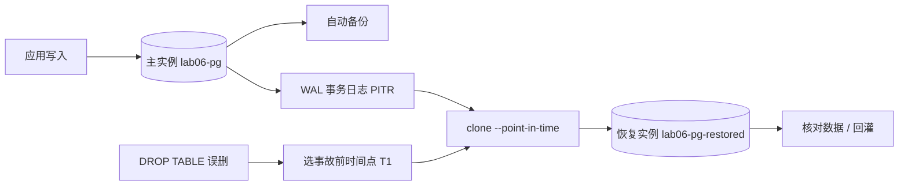

# 练习 6：Cloud SQL（PostgreSQL）时间点恢复 PITR

> 路线图第四节。交付物：**实测 RPO/RTO 的一次真实 PITR 恢复**。
> 铁律：先跑通 → 再破坏-修复；**不在免费额度，练完立刻删**。

## 为什么这练习值钱

对应「备份 / 容灾」（高 ROI，老本行）。把传统备份里的「备份窗口 / 日志前滚」换成云上的**自动备份 + WAL 事务日志**，再用一次真实的 `DROP TABLE` 事故，把 RPO / RTO 用秒表量出来——这是简历上能写「实测过」和「听说过」的分水岭。



## 成本红线（先看这条）

- Cloud SQL **不在免费额度**：`db-f1-micro`（共享核）+ 10GB SSD + PITR 事务日志都按小时/GB 计费。
- PITR 恢复会**新建一台完整实例**，恢复期间是双倍计费。
- 开 `regional` HA（可选加餐）价格再翻倍。
- 建议一次做完、2 小时内删干净；创建时务必带 `--no-deletion-protection`，否则最后删不掉还要先 patch。

## 前置（2026-11-06 已核）

- [x] `sqladmin.googleapis.com` 已启用（`gcloud services enable`，本次开工时做的）
- [x] `db-f1-micro` 在 `us-central1` 可用（`gcloud sql tiers list` 实测）
- [x] 本机 gcloud 支持 `--enable-point-in-time-recovery`、`clone --point-in-time`、`get-latest-recovery-time`
- [ ] 数据库客户端（二选一，见「连库」）：① 自己终端 `brew install libpq`；② 不装客户端，直接用控制台 **Cloud SQL Studio**（零安装，推荐）
- [ ] 代理：本机默认代理对 Google API 报 Bad Gateway，四个变量全指向 squid `127.0.0.1:3128`

```bash
export HTTP_PROXY=http://127.0.0.1:3128 HTTPS_PROXY=http://127.0.0.1:3128
export http_proxy=http://127.0.0.1:3128 https_proxy=http://127.0.0.1:3128
# 若装了 libpq，把 psql 加进 PATH：
export PATH="/usr/local/opt/libpq/bin:$PATH"
```

> 练习 6 用 gcloud 手搓，不复用练习 4/5 的 Terraform：这练的是「备份容灾」，不是 IaC。把注意力放在数据能不能回来。

---

## 第一轮：跑通

### 1. 建实例（约 5–10 分钟，最费时间的一步）

```bash
export PGPASSWORD="$(openssl rand -base64 18)"   # 只存在当前终端，别写进仓库

gcloud sql instances create lab06-pg \
  --database-version=POSTGRES_15 \
  --tier=db-f1-micro \
  --region=us-central1 \
  --availability-type=zonal \
  --storage-size=10GB \
  --storage-type=SSD \
  --no-storage-auto-increase \
  --enable-point-in-time-recovery \
  --backup-start-time=02:00 \
  --no-deletion-protection \
  --root-password="$PGPASSWORD"

gcloud sql instances describe lab06-pg \
  --format='table(name,state,settings.tier,settings.availabilityType,settings.backupConfiguration.pointInTimeRecoveryEnabled)'
```

**观察点**：`--enable-point-in-time-recovery` 是这次实验的命门——它打开 WAL 事务日志，没有它只能恢复到整点备份，谈不上「时间点」。描述输出里确认 `pointInTimeRecoveryEnabled = True`。

### 2. 连库

> **先把密码拿出来**：创建实例时 `--root-password="$PGPASSWORD"` 用的是当前终端的环境变量，换终端或用 Studio 登录前先跑 `echo $PGPASSWORD` 复制出来存好（别贴进仓库、别发聊天记录）。密码丢了可以用 `gcloud sql users set-password postgres --instance=lab06-pg --password=...` 重设。

**路线 A：命令行**（需要本机有 psql）。在你自己的终端装：

```bash
brew install libpq
export PATH="/usr/local/opt/libpq/bin:$PATH"
gcloud sql connect lab06-pg --user=postgres --quiet
```

> 环境备注：WorkBuddy 的执行沙箱里 brew 调不了 `sandbox-exec`（`sandbox_apply: Operation not permitted`），装 libpq 会失败——这一步**必须在你自己的终端**做，别在 AI 侧重试。

> **Studio 打不开就别耗时间，直接走路线 A**：控制台报 `Failed to load: sqladmin.googleapis.com?...` 是浏览器/网络层加载失败，跟数据库本身无关（实例仍是 RUNNABLE）。
> 命令行反而更贴近真实生产。同一个终端里 `PGPASSWORD` 还活着，psql 会自动读取、不用手输密码；连进去后在仓库目录下 `\i sql/01_seed.sql` 一把梭即可（脚本自带 `CREATE DATABASE` + `\connect`）。

**路线 B：控制台（推荐，零安装）**：打开 **Cloud SQL Studio**，把 `sql/` 里的脚本粘进去执行。零客户端、零网络排障。

新版 `gcloud sql connect` 走内置 Cloud SQL Proxy，会自动处理授权；两条路效果一样。`sql/` 脚本里已注明 Studio 用户要跳过 `\connect` 这类 psql 元命令（先单独建库，再把数据库切到 `lab06`）。

### 3. 先打一次手动备份（建立恢复基线，别省）

实例刚建好，自动备份窗口设在 `02:00 UTC`——今天这班已经过了，下一次要等明天，所以**此刻一台备份都没有**。PITR 的原理是「拿目标时间点之前最近的一次备份当底座，再把 WAL 事务日志往前滚」，没有底座就没有恢复窗口。

```bash
gcloud sql backups create --instance=lab06-pg --description='lab06 baseline'
gcloud sql backups list --instance=lab06-pg --format='table(id,status,startTime)'
gcloud sql instances get-latest-recovery-time lab06-pg
```

等备份状态变成 `SUCCESS` 再往下走。这条备份在造数据**之前**，正好演示 PITR 的精髓：备份只是起点，后面几分钟的数据全靠 WAL 前滚找回来。

### 4. 造数据 + 记时间点（RPO/RTO 全靠这一步）

把 `sql/01_seed.sql` 贴进去，最后 `SELECT count(*)` 应为 **5**，立刻记 **T0**。
**psql 用户**整段可贴；**Cloud SQL Studio 用户**先单独跑 `CREATE DATABASE lab06;`，在界面里把库切到 `lab06`，再从 `CREATE TABLE` 开始贴（Studio 不认 `\connect` 这类 psql 元命令）。

记时间统一用这条（UTC、带毫秒、带 Z，clone 只认这个格式）：

```bash
python3 -c 'import datetime;print(datetime.datetime.now(datetime.timezone.utc).isoformat(timespec="milliseconds").replace("+00:00","Z"))'
```

按顺序做，别跳步：

```sql
-- ① 事故前的正常业务数据（这些应该被恢复出来）
INSERT INTO orders (item, amount) VALUES
  ('tea-003', 52.00), ('herb-004', 21.50), ('tea-004', 36.00);   -- 累计 8 行
```

等 **2–3 分钟**让 WAL 归档攒起来，记 **T1**（这就是待会儿 clone 的目标点，此时 8 行都在、DROP 还没发生）。

```sql
-- ② T1 之后才写的「最后一刻订单」（恢复不到，就是 RPO 实测丢掉的部分）
INSERT INTO orders (item, amount) VALUES
  ('herb-005', 18.00), ('tea-005', 41.00);                       -- 累计 10 行
SELECT count(*) FROM orders;                                      -- 确认 10
```

| 时间点 | 值（UTC） | 含义 |
|--------|-----------|------|
| T0 | | 种子 5 行完成 |
| T1 | | 恢复目标：8 行都在、DROP 之前 |
| T_break | | 误删发生（此时表里有 10 行） |
| T_restore_start | | 发起 clone |
| T_restore_ready | | 恢复实例可查 |

> 恢复到 T1 后应该是 **8 行**：T1 之后那 2 行拿不回来，这就是 RPO 的真实数值，而不是「0」。

---

## 第二轮：破坏-修复（自己敲、自己定位）

### 破坏 1：DROP TABLE

贴 `sql/02_break.sql`（执行前记 **T_break**）：

```sql
SELECT count(*) FROM orders;   -- 先确认 10 行，这就是事故瞬间总共要面对的数据
DROP TABLE orders;
SELECT count(*) FROM orders;   -- 预期报错：relation "orders" does not exist
```

### 修复：查窗口 → 克隆到新实例 → 验证

```bash
# 1. 看能恢复到哪个时间范围
gcloud sql instances get-latest-recovery-time lab06-pg

# 2. 恢复到 T1（把 <T1> 换成你第 4 步实测记下的 UTC 时间，别照抄示例）
#    示例格式：2026-11-07T03:50:00.000Z
gcloud sql instances clone lab06-pg lab06-pg-restored \
  --point-in-time '<T1>'

gcloud sql instances describe lab06-pg-restored --format='value(state)'
```

**三条必踩的坑，先记住再排查**：

1. **PITR 永远创建新实例，不能原地恢复**（官方明文：`A point-in-time recovery always creates a new instance`）。所以业务侧要么切连接串，要么把数据回灌——这正是 RTO 的大头。
2. **T1 必须落在恢复窗口内**（`earliestRecoveryTime` ~ `latestRecoveryTime`），而且窗口要有**备份基线**：新建实例没做过任何备份时，先按第 3 步打一次按需备份，否则 clone 会直接失败。恢复到太早的时间点同样会失败，等几分钟让 WAL 归档再试。
3. **时间点格式**：RFC3339 UTC，形如 `2026-11-07T03:50:00.094Z`（仅示意格式，日期时间按当天实测）；写成本地时间（GMT+8）会直接对不上。

验证（连**恢复实例**：命令行 `gcloud sql connect lab06-pg-restored --user=postgres --quiet`，或 Studio 里切到该实例，数据库选 `lab06`；贴 `sql/03_verify.sql`）：

```sql
SELECT count(*) FROM orders;   -- 应为 8；T1 之后写的那 2 条不该在
```

### RPO / RTO 实测表（自己填）

| 指标 | 怎么算 | 实测值 |
|------|--------|--------|
| **RPO**（最多丢多少数据） | T1 → T_break 之间写入的行数（本轮 2 行）/ 时间窗口 | |
| **RTO**（多久恢复服务） | T_restore_ready − T_break | |
| 恢复实例创建耗时 | T_restore_ready − T_restore_start | |
| 实际可恢复粒度 | 秒级 / 分钟级（看 get-latest-recovery-time） | |

**结论要回答的问题**：如果这是真生产，丢了什么、停了多久、下一步怎么把 RTO 压下来（预案脚本、连接串自动切换、只读副本等）。

### 破坏 2（可选加餐）：HA failover

路线图里还有 `failover 实测`，但要把实例改成 `--availability-type=regional`（价格翻倍、要重建）。想做的话另开一轮：

```bash
gcloud sql instances patch lab06-pg --availability-type=regional
gcloud sql instances failover lab06-pg
# 用一个循环持续 SELECT 1，数中断了多少秒
```

**建议**：主线 PITR 先闭环，HA 加餐看预算再决定，别让一台 regional 实例过夜。

---

## 收尾（必须，别让账单过夜）

```bash
gcloud sql instances delete lab06-pg-restored --quiet
gcloud sql instances delete lab06-pg --quiet
gcloud sql instances list                     # 预期空
```

删除前确认 `--no-deletion-protection` 生效；删完把上面的 RPO/RTO 表和「What I broke and how I fixed it」补进本文件，再 commit。

## 文件

- `sql/01_seed.sql` — 建库、建表、种子数据
- `sql/02_break.sql` — 误删（破坏）
- `sql/03_verify.sql` — 在恢复实例上核对数据
