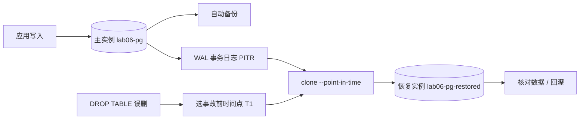

# 练习 6：Cloud SQL（PostgreSQL）时间点恢复 PITR

> 路线图第四节。交付物：**实测 RPO/RTO 的一次真实 PITR 恢复**。  
> 铁律：先跑通 → 再破坏-修复；**不在免费额度，练完立刻删**。

## 为什么这练习值钱

对应「备份 / 容灾」（高 ROI，老本行）。把传统备份里的「备份窗口 / 日志前滚」换成云上的**自动备份 + WAL 事务日志**，再用一次真实的 `DROP TABLE` 事故，把 RPO / RTO 用秒表量出来——这是简历上能写「实测过」和「听说过」的分水岭。



## 成本红线（先看这条）

- Cloud SQL **不在免费额度**：`db-f1-micro`（共享核）+ 10GB SSD + PITR 事务日志都按小时/GB 计费。
- PITR 恢复会**新建一台完整实例**，恢复期间是双倍计费。
- 开 `regional` HA（可选加餐）价格再翻倍。
- 建议一次做完、2 小时内删干净；创建时务必带 `--no-deletion-protection`，否则最后删不掉还要先 patch。

## 前置（2026-11-06 已核）

- [x] `sqladmin.googleapis.com` 已启用（`gcloud services enable`，本次开工时做的）
- [x] `db-f1-micro` 在 `us-central1` 可用（`gcloud sql tiers list` 实测）
- [x] 本机 gcloud 支持 `--enable-point-in-time-recovery`、`clone --point-in-time`、`get-latest-recovery-time`
- [ ] 数据库客户端（三选一，见「连库」）：① **Python 驱动 + `sql/pg.py`（本机首选，零编译）**；② 自己终端 `brew install libpq`（**Intel Mac 已装不上**）；③ 控制台 **Cloud SQL Studio**（本机加载失败过）
- [ ] 代理：本机默认代理对 Google API 报 Bad Gateway，四个变量全指向 squid `127.0.0.1:3128`

```bash
export HTTP_PROXY=http://127.0.0.1:3128 HTTPS_PROXY=http://127.0.0.1:3128
export http_proxy=http://127.0.0.1:3128 https_proxy=http://127.0.0.1:3128
# 若装了 libpq，把 psql 加进 PATH：
export PATH="/usr/local/opt/libpq/bin:$PATH"
```

> 练习 6 用 gcloud 手搓，不复用练习 4/5 的 Terraform：这练的是「备份容灾」，不是 IaC。把注意力放在数据能不能回来。


---

## 第一轮：跑通

### 1. 建实例（约 5–10 分钟，最费时间的一步）

```bash
export PGPASSWORD="$(openssl rand -base64 18)"   # 只存在当前终端，别写进仓库

gcloud sql instances create lab06-pg \
  --database-version=POSTGRES_15 \
  --tier=db-f1-micro \
  --region=us-central1 \
  --availability-type=zonal \
  --storage-size=10GB \
  --storage-type=SSD \
  --no-storage-auto-increase \
  --enable-point-in-time-recovery \
  --backup-start-time=02:00 \
  --no-deletion-protection \
  --root-password="$PGPASSWORD"

gcloud sql instances describe lab06-pg \
  --format='table(name,state,settings.tier,settings.availabilityType,settings.backupConfiguration.pointInTimeRecoveryEnabled)'
```

**观察点**：`--enable-point-in-time-recovery` 是这次实验的命门——它打开 WAL 事务日志，没有它只能恢复到整点备份，谈不上「时间点」。描述输出里确认 `pointInTimeRecoveryEnabled = True`。

### 2. 连库

> **先把密码拿出来**：创建实例时 `--root-password="$PGPASSWORD"` 用的是当前终端的环境变量，换终端或用 Studio 登录前先跑 `echo $PGPASSWORD` 复制出来存好（别贴进仓库、别发聊天记录）。密码丢了可以用 `gcloud sql users set-password postgres --instance=lab06-pg --password=...` 重设。

**路线 C：Python 驱动（本机首选，零编译）** — Intel Mac 上 Homebrew 已经装不了 libpq（见下），这条路绕开编译和 psql：

```bash
# 一次性准备（仓库根目录，已内置）
cd ~/gcp-ops-labs
python3 -m venv .venv-lab06
.venv-lab06/bin/pip install psycopg2-binary     # 有 Intel 预编译包，不编译

# 每次使用：先放行本机 IP（公网直连，做完记得清）
cd 06-cloudsql-pitr
# api.ipify.org 在本机网络常返回空；--noproxy 绕开 Clash 系统代理，多源兜底
for u in https://checkip.amazonaws.com https://ifconfig.me https://api.ipify.org; do
  MYIP=$(curl -s --noproxy '*' -m 10 "$u" | tr -d '[:space:]')
  [ -n "$MYIP" ] && break
done
echo "MYIP=[$MYIP]"
[[ "$MYIP" =~ ^[0-9.]+$ ]] && echo "IP 合法，继续" || echo "没拿到IP，别往下跑"
gcloud sql instances patch lab06-pg --authorized-networks="$MYIP/32" --quiet

# 实例 IP 每次新建都会变，别写死，动态取
export PGHOST=$(gcloud sql instances describe lab06-pg --format='value(ipAddresses[0].ipAddress)')
export PGUSER=postgres PGPASSWORD='<你的密码>' PGDATABASE=postgres
echo "PGHOST=$PGHOST"
../.venv-lab06/bin/python sql/pg.py -f sql/01_seed.sql
```

`sql/pg.py` 是个迷你 psql：支持 `\connect` 切库、`--` 注释、逐条执行并在报错后继续（所以 `02_break.sql` 里 DROP 之后那条 `count(*)` 的报错会照实打出来，正是我们要的现场）。查询结果直接打成表格。

> 用完清敞口：`gcloud sql instances patch lab06-pg --clear-authorized-networks`

**路线 A：psql（最正统，但本机装不上）**：

```bash
brew install libpq
export PATH="$(brew --prefix libpq)/bin:$PATH"
gcloud sql connect lab06-pg --user=postgres --quiet
```

> **2026-11-07 实测：Intel Mac 上这条路走不通。** Homebrew 自 2026-09 起把 macOS Intel 降为 Tier 3，不再提供该配置的瓶子；`libpq` 依赖的 `icu4c@79` 只能源码编译，而你机器上的 Command Line Tools 16.4 编不过（`stubdata.cpp` 报 `#include <memory>` 相关错误，`make[1]: *** [stubdata.o] Error 1`）。  
> 想装真 psql 只有两条路：① 升 CLT 到 26.3（系统设置里更新，或 `sudo rm -rf /Library/Developer/CommandLineTools && sudo xcode-select --install`，要几个 G）；② 换 MacPorts。都不急，练习用路线 C 就行。


> 环境备注：WorkBuddy 的执行沙箱里 brew 调不了 `sandbox-exec`（`sandbox_apply: Operation not permitted`），装 libpq 会失败——这一步**必须在你自己的终端**做，别在 AI 侧重试。

> **Studio 打不开就别耗时间**：控制台报 `Failed to load: sqladmin.googleapis.com?...` 是浏览器/网络层加载失败，跟数据库本身无关（实例仍是 RUNNABLE）。

**路线 B：控制台（零安装，但本机加载失败过）**：打开 **Cloud SQL Studio**，把 `sql/` 里的脚本粘进去执行。`sql/` 脚本里已注明 Studio 用户要跳过 `\connect` 这类 psql 元命令（先单独建库，再把数据库切到 `lab06`）。

### 3. 先打一次手动备份（建立恢复基线，别省）

实例刚建好，自动备份窗口设在 `02:00 UTC`——今天这班已经过了，下一次要等明天，所以**此刻一台备份都没有**。PITR 的原理是「拿目标时间点之前最近的一次备份当底座，再把 WAL 事务日志往前滚」，没有底座就没有恢复窗口。

```bash
gcloud sql backups create --instance=lab06-pg --description='lab06 baseline'
gcloud sql backups list --instance=lab06-pg --format='table(id,status,startTime)'
gcloud sql instances get-latest-recovery-time lab06-pg
```

等备份状态变成 `SUCCESS` 再往下走。这条备份在造数据**之前**，正好演示 PITR 的精髓：备份只是起点，后面几分钟的数据全靠 WAL 前滚找回来。

### 4. 造数据 + 记时间点（RPO/RTO 全靠这一步）

把 `sql/01_seed.sql` 整段跑一遍（`../.venv-lab06/bin/python sql/pg.py -f sql/01_seed.sql`），最后 `SELECT count(*)` 应为 **5**，立刻记 **T0**。  
**pg.py / psql 用户**整段可贴（`\connect` 会被识别）；**Cloud SQL Studio 用户**先单独跑 `CREATE DATABASE lab06;`，在界面里把库切到 `lab06`，再从 `CREATE TABLE` 开始贴（Studio 不认 `\connect` 这类 psql 元命令）。

记时间统一用这条（UTC、带毫秒、带 Z，clone 只认这个格式）：

```bash
python3 -c 'import datetime;print(datetime.datetime.now(datetime.timezone.utc).isoformat(timespec="milliseconds").replace("+00:00","Z"))'
```

按顺序做，别跳步：

```sql
-- ① 事故前的正常业务数据（这些应该被恢复出来）
INSERT INTO orders (item, amount) VALUES
  ('tea-003', 52.00), ('herb-004', 21.50), ('tea-004', 36.00);   -- 累计 8 行
```

等 **2–3 分钟**让 WAL 归档攒起来，记 **T1**（这就是待会儿 clone 的目标点，此时 8 行都在、DROP 还没发生）。

```sql
-- ② T1 之后才写的「最后一刻订单」（恢复不到，就是 RPO 实测丢掉的部分）
INSERT INTO orders (item, amount) VALUES
  ('herb-005', 18.00), ('tea-005', 41.00);                       -- 累计 10 行
SELECT count(*) FROM orders;                                      -- 确认 10
```

| 时间点             | 值（UTC） | 含义                 |
| --------------- | ------ | ------------------ |
| T0              |        | 种子 5 行完成           |
| T1              |        | 恢复目标：8 行都在、DROP 之前 |
| T_break         |        | 误删发生（此时表里有 10 行）   |
| T_restore_start |        | 发起 clone           |
| T_restore_ready |        | 恢复实例可查             |

> 恢复到 T1 后应该是 **8 行**：T1 之后那 2 行拿不回来，这就是 RPO 的真实数值，而不是「0」。

---

## 第二轮：破坏-修复（自己敲、自己定位）

### 破坏 1：DROP TABLE

贴 `sql/02_break.sql`（执行前记 **T_break**）。用 pg.py 就是一条命令：

```bash
../.venv-lab06/bin/python sql/pg.py -f sql/02_break.sql --db lab06
```

```sql
SELECT count(*) FROM orders;   -- 先确认 10 行，这就是事故瞬间总共要面对的数据
DROP TABLE orders;
SELECT count(*) FROM orders;   -- 预期报错：relation "orders" does not exist
```

### 修复：查窗口 → 克隆到新实例 → 验证

```bash
# 1. 看能恢复到哪个时间范围
gcloud sql instances get-latest-recovery-time lab06-pg

# 2. 恢复到 T1（把 <T1> 换成你第 4 步实测记下的 UTC 时间，别照抄示例）
#    示例格式：2026-11-07T03:50:00.000Z
gcloud sql instances clone lab06-pg lab06-pg-restored \
  --point-in-time '<T1>'

gcloud sql instances describe lab06-pg-restored --format='value(state)'
```

**三条必踩的坑，先记住再排查**：

1. **PITR 永远创建新实例，不能原地恢复**（官方明文：`A point-in-time recovery always creates a new instance`）。所以业务侧要么切连接串，要么把数据回灌——这正是 RTO 的大头。
2. **T1 必须落在恢复窗口内**（`earliestRecoveryTime` ~ `latestRecoveryTime`），而且窗口要有**备份基线**：新建实例没做过任何备份时，先按第 3 步打一次按需备份，否则 clone 会直接失败。恢复到太早的时间点同样会失败，等几分钟让 WAL 归档再试。
3. **时间点格式**：RFC3339 UTC，形如 `2026-11-07T03:50:00.094Z`（仅示意格式，日期时间按当天实测）；写成本地时间（GMT+8）会直接对不上。

验证（连**恢复实例**：pg.py 用 `PGHOST=<恢复实例IP> ... --db lab06`，或 `gcloud sql connect lab06-pg-restored --user=postgres --quiet`，或 Studio 里切到该实例选 `lab06`；贴 `sql/03_verify.sql`）：

```bash
export PGHOST=$(gcloud sql instances describe lab06-pg-restored --format='value(ipAddresses[0].ipAddress)')
../.venv-lab06/bin/python sql/pg.py -f sql/03_verify.sql --db lab06
```

```sql
SELECT count(*) FROM orders;   -- 应为 8；T1 之后写的那 2 条不该在
```

### RPO / RTO 实测表（自己填）

| 指标               | 怎么算                                  | 实测值 |
| ---------------- | ------------------------------------ | --- |
| **RPO**（最多丢多少数据） | T1 → T_break 之间写入的行数（本轮 2 行）/ 时间窗口   |     |
| **RTO**（多久恢复服务）  | T_restore_ready − T_break            |     |
| 恢复实例创建耗时         | T_restore_ready − T_restore_start    |     |
| 实际可恢复粒度          | 秒级 / 分钟级（看 get-latest-recovery-time） |     |

**结论要回答的问题**：如果这是真生产，丢了什么、停了多久、下一步怎么把 RTO 压下来（取证定锚、
预演 runbook、冻结写入、单表数据手术、连接串自动切换等；**只读副本防不了逻辑误删**）。

### 破坏 2（可选加餐）：HA failover

路线图里还有 `failover 实测`，但要把实例改成 `--availability-type=regional`（价格翻倍、要重建）。想做的话另开一轮：

```bash
gcloud sql instances patch lab06-pg --availability-type=regional
gcloud sql instances failover lab06-pg
# 用一个循环持续 SELECT 1，数中断了多少秒
```

**建议**：主线 PITR 先闭环，HA 加餐看预算再决定，别让一台 regional 实例过夜。

---

## 收尾（必须，别让账单过夜）

```bash
gcloud sql instances delete lab06-pg-restored --quiet
gcloud sql instances delete lab06-pg --quiet
gcloud sql instances list                     # 预期空
```

删除前确认 `--no-deletion-protection` 生效；删完把上面的 RPO/RTO 表和「What I broke and how I fixed it」补进本文件，再 commit。
若跑了「补测实验：审计定锚 → 前滚」，那里有 **3 台** `lab06-pg-*` 要删，且开了备份保留、还需手动清备份，见该节第 7 步。

## 实战记录（2026-11-07 晚场）

时间线（全部 UTC）：

| 时间点             | 实测值                        | 说明                                               |
| --------------- | -------------------------- | ------------------------------------------------ |
| T0              | `2026-11-07T15:34:50.522Z` | 种子 5 行完成（`01_seed.sql`，pg.py `--db lab06`）       |
| T1              | `2026-11-07T15:53:18.641Z` | 恢复目标点：插 3 条后 8 行、DROP 前                          |
| T_break         | `2026-11-07T16:00:33.415Z` | `02_break.sql` DROP TABLE orders（当时 10 行）        |
| T_restore_start | `2026-11-07T16:07:47.501Z` | `clone --point-in-time` 发起（operation insertTime） |
| T_restore_ready | `2026-11-07T16:47:53.516Z` | 恢复实例 `RUNNABLE` + 白名单 patch 完成，可连接               |

clone 前体检（全部通过）：

- 恢复窗口：`earliestRecoveryTime 02:42:07` ~ `latestRecoveryTime 15:58:12`，T1 落在窗口内
- 备份基线：3 个 SUCCESSFUL，最近一次 `15:27:04`（早于 T1）
- 客户端：pg.py + `--db lab06`（Intel Mac 装不上 libpq，见「连库」一节）

**当晚的坑：clone「看起来失败」其实没有失败。** gcloud 等了约 10 分钟后退出，报  
`Operation ... is taking longer than expected`——这是客户端放弃等待，不是服务器失败。  
用 `gcloud sql operations describe <operation-id> --project lukechengtest` 查，服务器端 `status: RUNNING`，  
恢复实例仍在后台建（最终 `DONE`，成功）。教训：**SQL 操作的成败只认 operations 的 status，别信 gcloud 前台的退出信息**。

其他当晚踩坑：

- op 未收尾时对新实例 patch 会撞 `409 Operation failed because another operation was already in progress`，等 `DONE` 再操作。
- `gcloud beta sql operations wait` 卡死不返回（op 已 DONE 还在等）——polling `describe` 更可靠。
- WorkBuddy 环境里大小写两组代理变量都要清（`http_proxy/https_proxy` **和** `HTTP_PROXY/HTTPS_PROXY`），只清小写时 gcloud 仍会走大写那组、撞 502 Bad Gateway。

**验证结果（2026-11-07T16:53Z，恢复实例 `lab06-pg-restored` / IP `136.112.17.194`，`03_verify.sql`）：**

- `SELECT count(*) FROM orders` → **8 行** ✅（5 条种子 + tea-003 / herb-004 / tea-004）
- herb-005、tea-005 不在恢复实例里——T1 之后那 2 条订单拿不回来，RPO 实测命中预期
- 数据内容逐行核对无误（id 1~8，金额与写入时一致）

### RPO / RTO 实测结果（2026-11-07 实跑）


| 指标 | 怎么算 | 实测值 |
|------|--------|--------|
| **RPO**（最多丢多少数据） | T1 → T_break 之间写入的行数 / 时间窗口 | **2 行 / 7 分 15 秒**（herb-005、tea-005，`15:53:18→16:00:33`）。**这是「选择恢复到 T1」的结果，主实例存活时不是 PITR 的物理下限** |
| **RTO**（多久恢复服务） | T_restore_ready − T_break | **约 47 分钟**（`16:00:33→16:47:53`） |
| 恢复实例创建耗时 | T_restore_ready − T_restore_start | 约 40 分钟（`db-f1-micro`，其中含 op 排队 + 白名单 patch） |
| 实际可恢复粒度 | get-latest-recovery-time | 秒级窗口可指定；但落点受最近一次备份（15:27）+ WAL 覆盖限制 |

**结论**：PITR 能把误删救回来，但「建新实例等 40 分钟」决定了 RTO 下限。真生产压 RTO 的三板斧是
**好取证少猜、预演过的 runbook、事故第一时间冻结写入**；再配合「clone 出来只回灌出事那张表」的
数据手术，能把整库切换的 1 小时压成单表回灌的几分钟（见 FAQ 3）。RPO 则由**你能确认事故时刻的精度**
决定，而不是备份频率：事故点越清楚，恢复点就能贴得越近，丢得越少。

**RPO 要分两种故障看**（2026-11-08 复核补充）：

- **主实例还活着（逻辑误删）**：WAL 在本地、会陆续归档，等窗口追上后能恢复到事故前一瞬，
  **数据可以接近零丢失**——本轮「丢 2 行」纯粹是选了保守点 T1。
- **主实例主机挂了**：最多丢「归档滞后」那一段窗口（本轮实测 2 分 20 秒），HA 靠同步复制堵这个口子。
- **第三块最容易漏**：事故后到切流之间写进**原库**的新数据，clone 里不会有。
  所以真实事故第一动作是**冻结写入**。

> 2026-11-08 更正（一）：原结论写的「配只读副本 / 预建 standby 压 RTO」对**逻辑误删无效**。
> `DROP TABLE` 会秒级同步到只读副本和 HA 备机，副本上表同样没了。HA 防的是机器 / 机房故障，
> 防人为误删的最后一道防线仍是 PITR clone。
>
> 2026-11-08 更正（二，Claude 复核）：随后写的「并行 fan-out 多个候选恢复点」**在 Cloud SQL 不成立**——
> 同一实例任意时刻只容一个管理操作，第二个 clone 提交时直接 409 `operationInProgress`、**不排队**。
> 只能串行逼近，详见 FAQ 2。

### FAQ：能不能恢复到 T_break，把最后 2 条也找回来？

**能，而且这正是 PITR 的正确用法。** 本轮 `T_break = 16:00:33.415Z` 是「先打印时间、再粘贴执行
`02_break.sql`」记下的，所以那一刻 DROP 还没发生，表里是 **10 行**。用同一份基线备份 +
WAL 前滚到 `16:00:33.415Z`，最后 2 条（herb-005 / tea-005）会被重放出来，10 行全在：

```bash
gcloud sql instances clone lab06-pg lab06-pg-full --point-in-time='2026-11-07T16:00:33.415Z'
```

> 精度提醒（复核补充）：别指望毫秒级卡点，恢复点往前留 **2–3 秒余量**（如 `16:00:30Z`）更稳。
> 本轮 T_break 与 DROP 之间本来就没有写入，所以取 T_break 本身也安全。

三条必须记住的边界：

1. **恢复点要卡在 DROP 之前，不是越新越好。** `DROP TABLE` 在 PostgreSQL 里也是写 WAL 的事务，
   前滚会把它一起重放；选在 DROP 之后，新实例里 `orders` 表照样不存在。PITR 不是「回到最新」，
   是「回到事故前一秒」。
2. **`latestRecoveryTime` 有滞后。** 16:00:33 查到的窗口只到 `15:58:12`（WAL 归档滞后约 2 分 20 秒），
   当时立刻 clone 会被拒；要等窗口推进过 T_break（约 16:02 之后）再发起。WAL 默认保留 7 天，
   等一等不会丢数据。
3. **主实例存活时，事故点越清楚，RPO 越接近 0。** 本轮故意选 T1 是在演示「不知道事故几点」
   时的保守决策；本表的「2 行」不是 PITR 的能力上限（主机故障另有归档滞后地板，见上方 RPO 分两种故障）。

> 2026-11-08 追记：本轮两台实例当晚已删除，备份与 WAL 日志随实例一并清除
> （创建时未加 `--retain-backups-on-delete`），因此**无法再补一次 clone 到 T_break 做对照实验**。
> 下轮重跑时建议加餐：同一实例连 clone 两次（T1 与 T_break），分别连进去 `count(*)`，
> 直接看到 8 行 vs 10 行的差别——这是理解「恢复点决定 RPO」最直观的一组对照。

### FAQ 2：为什么 latestRecoveryTime 有滞后？猜错时间点怎么办？

**滞后不是 bug，是 PITR 的工作方式。** 官方定义 `latestRecoveryTime` 就是「最晚可恢复到的时间点」。
按机制推断（Cloud SQL 托管侧的归档节奏未公开，以下是按 PostgreSQL 通用机制的解释，**不是官方事实**）：
PITR 靠持续把 WAL 日志搬到 Cloud Storage，事务提交后先落在主实例本地 WAL，只有当一个 WAL 段被
**封口 → 上传 → 登记**完成，里面的事务才算「可恢复」，所以时间戳天然落后于当前时间。

- **写入越少，滞后越大**（复核补充）：低流量实例 WAL 段填得慢，更依赖超时切段；持续写入时切段快、
  滞后更小。本轮 `db-f1-micro` 一晚才几条 INSERT，实测滞后 **2 分 20 秒**（16:00:33 查到的窗口只到 15:58:12）。
  → 「16MB / 超时切段」只是原生 PostgreSQL 的机制类比，**别当成托管服务的确定实现**；
  2 分 20 秒也只是本轮实测值，官方没给典型滞后量级，别写成常数。
- 上传 + 服务端刷新恢复窗口元数据还有一层延迟，API 返回值可能不是刚刚那一刻。
- **这段滞后是「主机故障」场景的 RPO 地板**：等对时间点没事（WAL 保留期内随时补），但主实例主机若在这
  两分钟里彻底挂掉、WAL 还没搬走，这些事务就真丢了。HA 实例靠同步复制到备机堵这个口子。
- 另一个方向：`earliestRecoveryTime` 与最老备份 + 日志保留有关，备份过期就往后推；PostgreSQL 的
  `transactionLogRetentionDays` 默认 7 天、可配 1–7 天（以官方页为准）。事故别拖，越拖能选的点越少。

**猜错时间点可以换，不用手动重做 baseline。** 两条关键事实：

1. PITR **永远建新实例、源实例不动**。猜错了就删掉这个错 clone，换个时间戳再 clone 一次。
2. 「基线备份 + WAL 前滚」是服务端每次 clone 自动做的，备份只读、可反复用。既不需要、也没法手动
   「先 restore baseline 再 roll forward 第二遍」。多付的只是**又一次完整 clone 的时间**，不是两道工序。

**⚠️ 但必须串行（2026-11-08 Claude 复核纠正，原文已作废）。** Cloud SQL **同一实例任意时刻只容
一个管理操作**，第二个 `clone` 提交时直接 409 `operationInProgress`、**不排队**。本轮实战也撞过同类
409（clone op 未收尾时给恢复实例 patch 被拒）。所以之前写的「同时发 3–4 个候选点、RTO ≈ 一次 clone」
**不成立**。

正确姿势是「**先取证定锚 → 一次 clone**」，而不是「先 clone 几次试试」（见 FAQ 3）。确实需要试探时，
用**串行二分**收敛：一次只发一个 clone，等它 `DONE` 后连进去检查结果，再决定下一个候选点；
有审计日志时通常 1–2 轮就够。

```bash
# 串行：一次一个，等完成后再决定下一个时间点
gcloud sql instances clone lab06-pg lab06-cand-1 \
  --point-in-time='2026-11-07T15:59:00.000Z' --quiet
gcloud sql operations describe <op-id> --project lukechengtest   # 轮询到 DONE，别用 beta operations wait
# 连进去 count(*) 检查；太早或太晚就删掉这个 clone，换时间点再发一个
```

操作上的坑（本轮踩过 + 复核补充）：每个 clone 要用**不同实例名**，注意项目实例配额；**授权网络不继承**，
连之前要各自 patch；**源实例绝不能删**（默认删实例即删备份，只有 `--retain-backups-on-delete` /
`--final-backup` 才保留）；日志保留期有限；clone 出来后还要把数据导回主实例或切连接串，
那段时间同样计入 RTO。

**别用 in-place restore**（复核补充）：官方提到它会**重置恢复窗口且不可撤销**，没把握时别碰；
`clone` 才是可反复试的安全路径。

### FAQ 3：真实事故里，恢复点到底怎么定？

> 这一节讲「为什么」，可直接敲的实操见下面「补测实验：审计定锚 → 前滚」。

**核心认知：恢复点不是「猜」出来的，是「取证」做出来的。** 顺序是「先取证 → 定锚 → 一次 clone」，
而不是「先 clone 几次试试」。证据源按实用性排序：

**① 数据库审计日志 —— 标准答案，不用改业务代码**

Cloud SQL PostgreSQL 支持 pgAudit：开 `cloudsql.enable_pgaudit=on` 标志，库里
`CREATE EXTENSION pgaudit;` 并设 `pgaudit.log='ddl,role'`，DDL 就带时间戳进 Cloud Logging。
事故时搜一条 `DROP TABLE`，恢复点精确到秒。只记 `ddl,role` 的日志量很小，成本可忽略。

**② 心跳表 —— 零依赖兜底，最俗最管用**

每 30–60 秒往一张小表插一行 `(now())`。clone 出来后看心跳表最后一行，立刻知道 clone 落在哪一刻、
离事故差多少。**必须放在和业务表分开的小表里**——业务表被 DROP 时心跳还在，clone 才能自证时间戳。

**③ 外部线索**

应用日志 / 发布记录（谁几点点了删除）、监控错误尖峰（事故开始时刻）、数据自带的
`created_at` / `updated_at`（恢复后圈定受影响行窗口）。

> 关于「给每个事务都加时间点」：`created_at` / `updated_at` 是标配，但**救不了 DDL 删表**——
> 时间戳跟着表一起被删了。真正扛事的证据必须是「表外」的：审计日志、心跳表、Cloud Logging。
> 侵入式地给每个业务事务打全局恢复标记，投入产出比很差，不建议。

**定锚之后：恢复点 = 坏事提交前一瞬，宁早勿晚。** 主实例还活着时 WAL 会陆续归档，等窗口追上就能
贴近事故点；不放心就往前留 2–3 秒。

**执行策略：数据手术（比反复 clone 划算）。** DROP 表这类事故，clone 到事故前 → 只把那张表
`pg_dump` 出来导回原库，其他表和线上流量全程不动，整体 RTO 从「整库切换 1 小时」压到
「单表回灌几分钟」。坏 UPDATE 同理：恢复前 / 后两个 clone 对比，只把错改的行合回去。

**RTO 的真实构成**：发现（监控告警）+ 决策 + clone（最大头）+ 验证 + 切流。
所以压 RTO 三板斧：**好取证少猜、预演过的 runbook、事故第一时间冻结写入**。
「冻结写入」最容易漏——事故后到切流之间写进**原库**的新数据，clone 里不会有，这部分也会丢。

**复制救不了逻辑误删**（复核补充）：Cloud SQL 是 WAL / 页级物理复制，DROP 秒级同步到只读副本和
HA 备机；平台**没有**延迟复制副本（那是 AWS RDS 的能力）。防手滑只能靠 PITR + 权限管控 + 审计。

<details>
<summary>复核来源（2026-11-08 Claude 提供，本会话网络未能直连核验）</summary>

- [执行时间点恢复 (PITR) — Cloud SQL for PostgreSQL 官方文档](https://docs.cloud.google.cn/sql/docs/postgres/backup-recovery/pitr)
- [Manage backups for deleted instances — Cloud SQL 官方文档](https://docs.cloud.google.com/sql/docs/sqlserver/backup-recovery/manage-backups-deleted-instance)
- [Cloud SQL backups and PITR — Exodus](https://exodus.elim.io/blog/backups-and-point-in-time-recovery-on-cloud-sql)
- [GCP 409 operationInProgress 案例 — DevOps AI Toolkit](https://devopsaitoolkit.com/blog/gcp-error-cloudsql-operation-already-in-progress/)
- [gcloud sql instances create — SDK 参考](https://clouddocs-dot-devsite-v2-prod.appspot.com/sdk/gcloud/reference/sql/instances/create)

</details>

## 明日重测速查（2026-11-09，从零起跑）

> 今晚实例已删，明天从零开始。这一章是**可直接照敲的精简版**；原理、命令拆解和踩坑细节见下一章「补测实验」。
> 预计 **2.5 小时**，其中两段 clone 各约 40 分钟且必须串行。跑不完也先执行第 8 步删环境，别过夜。

### 开工前：三条自检

```bash
G() { http_proxy= https_proxy= HTTP_PROXY= HTTPS_PROXY= gcloud "$@"; }
cd ~/gcp-ops-labs/06-cloudsql-pitr
G sql instances list
../.venv-lab06/bin/python -c "import psycopg2; print('OK')"
```

- `G()` 给 gcloud 清空代理（**大小写两组都要清**，只清小写会撞 502）；每个新终端窗口都要重新定义一次
- `instances list` 必须是 `Listed 0 items`，不是 0 台先查是谁在计费
- venv 若不在了：`python3 -m venv ../.venv-lab06 && ../.venv-lab06/bin/pip install psycopg2-binary`

### 第 1 步 · 建实例 + 补齐开关（约 15 分钟）

```bash
export PG_PASS='新密码'
G sql instances create lab06-pg \
  --database-version=POSTGRES_15 --tier=db-f1-micro --region=us-central1 \
  --availability-type=zonal --storage-size=10GB --storage-type=SSD \
  --no-storage-auto-increase --enable-point-in-time-recovery --backup-start-time=02:00 \
  --no-deletion-protection --root-password="$PG_PASS" --async
until G sql instances describe lab06-pg --format='value(state)' 2>/dev/null | grep -q RUNNABLE; do sleep 30; done

G sql instances patch lab06-pg --database-flags=cloudsql.enable_pgaudit=on,pgaudit.log=ddl --quiet
G sql instances patch lab06-pg --retain-backups-on-delete --quiet
G sql instances describe lab06-pg --format='value(state,settings.databaseFlags)'
```

> 两条 patch 撞 409 就等 30 秒重试；`describe` 里 flags 不能是空行。
> 审计只记**打开之后**的 DDL，所以必须在 DROP 之前补齐。

```bash
for u in https://checkip.amazonaws.com https://ifconfig.me https://api.ipify.org; do
  MYIP=$(curl -s --noproxy '*' -m 10 "$u" | tr -d '[:space:]'); [ -n "$MYIP" ] && break
done
echo "MYIP=[$MYIP]"
[[ "$MYIP" =~ ^[0-9.]+$ ]] && G sql instances patch lab06-pg --authorized-networks="$MYIP/32" --quiet

G sql backups create --instance=lab06-pg --description='baseline' --quiet
G sql backups list --instance=lab06-pg

export PGHOST=$(G sql instances describe lab06-pg --format='value(ipAddresses[0].ipAddress)')
export PGUSER=postgres PGDATABASE=postgres PGPASSWORD="$PG_PASS"
echo "PGHOST=$PGHOST"
```

> `api.ipify.org` 常返回空 → 多源兜底 + `--noproxy '*'`。**基线备份是 PITR 前提**，没有它 clone 必失败。
> 实例 IP 每次新建都变，一律动态取，别写死。

### 第 2 步 · 装扩展 + 审计预检（别跳）

```bash
../.venv-lab06/bin/python sql/pg.py -f sql/01_seed.sql
../.venv-lab06/bin/python sql/pg.py -c "CREATE EXTENSION IF NOT EXISTS pgaudit" --db lab06
../.venv-lab06/bin/python sql/pg.py -c "CREATE TABLE audit_probe(id int); DROP TABLE audit_probe" --db lab06
```

```bash
# 等 1~2 分钟日志投递再查
G logging read '"DROP TABLE"' --limit=10 --freshness=15m \
  --format='table(timestamp,protoPayload.request.command,protoPayload.request.statement)'
```

> `STATEMENT` 列出现 `DROP TABLE audit_probe` 才算链路通；搜不到先排查，**别往下 DROP**。
> `01_seed.sql` 只跑一次（INSERT 不去重，重跑 `orders` 直接变 10 行）。扩展必须装在 `lab06` 库。

### 第 3 步 · 造到 10 行（本轮不记 T1）

```bash
../.venv-lab06/bin/python sql/pg.py -c "INSERT INTO orders (item, amount) VALUES ('tea-003',52.00),('herb-004',21.50),('tea-004',36.00); SELECT count(*) FROM orders" --db lab06
# 上面应 8 行；等 1~2 分钟
../.venv-lab06/bin/python sql/pg.py -c "INSERT INTO orders (item, amount) VALUES ('herb-005',18.00),('tea-005',41.00); SELECT count(*) FROM orders" --db lab06
# 上面应 10 行；等 2~3 分钟给 WAL 归档
```

> **SQL 不是 shell 命令**：必须 `pg.py -c "一行 SQL" --db lab06`；
> 别带 `--` 注释，也别在命令末尾加 `# 8 行` 这类行尾注释（会被当参数传进 pg.py，今晚踩过）。
> 这轮**故意不手工记 T1**，恢复点全靠审计日志取证。

### 第 4 步 · 制造故障 + 审计定锚

```bash
../.venv-lab06/bin/python sql/pg.py -f sql/02_break.sql --db lab06
date -u +"%Y-%m-%dT%H:%M:%SZ"
```

```bash
# 等 1~2 分钟日志投递
G logging read 'protoPayload.request.statement:"DROP TABLE orders"' --limit=10 --freshness=30m \
  --format='table(timestamp,protoPayload.request.command,protoPayload.request.statement)'
```

拿到 `T_audit` 后算两个锚点（把引号里换成实际时间戳）：

```bash
T_AUDIT='2026-11-09THH:MM:SS.sssZ'
python3 -c "import datetime,sys;t=datetime.datetime.fromisoformat(sys.argv[1].replace('Z','+00:00'));f=lambda d:(t+datetime.timedelta(seconds=d)).isoformat(timespec='milliseconds').replace('+00:00','Z');print('PITR_BEFORE='+f(-5));print('PITR_AFTER ='+f(30))" "$T_AUDIT"
export PITR_BEFORE='<上面 BEFORE>' PITR_AFTER='<上面 AFTER>'
```

> `PITR_BEFORE` = 事故前 5 秒（应恢复出 10 行）；`PITR_AFTER` = 事故后 30 秒（DROP 被重放，表不存在）。
> `date -u` 只用来交叉验证审计时间戳合不合理，不参与定锚。

### 第 5 步 · 等恢复窗口越过锚点

```bash
G sql instances get-latest-recovery-time lab06-pg
```

> `latestRecoveryTime` 必须 ≥ `PITR_AFTER`（昨晚实测滞后 2 分 20 秒），不够就每 30 秒查一次。

### 第 6 步 · clone A（约 40 分钟，串行第一发）

```bash
date -u +"%Y-%m-%dT%H:%M:%SZ"
G sql instances clone lab06-pg lab06-pg-restored-a --point-in-time="$PITR_BEFORE" --async
until G sql instances describe lab06-pg-restored-a --format='value(state)' 2>/dev/null | grep -q RUNNABLE; do sleep 30; done
date -u +"%Y-%m-%dT%H:%M:%SZ"

G sql instances patch lab06-pg-restored-a --authorized-networks="$MYIP/32" --quiet
export PGHOST=$(G sql instances describe lab06-pg-restored-a --format='value(ipAddresses[0].ipAddress)')
../.venv-lab06/bin/python sql/pg.py -f sql/03_verify.sql --db lab06
```

> patch 撞 409 就等 30 秒重试。期望 **10 行**、`herb-005 / tea-005` 都在。
> 前台等 10 分钟报 `taking longer than expected` 是**假失败**，别信；用 `--async` + 轮询。

### 第 7 步 · clone B（再 40 分钟，必须等 A 彻底完成）

```bash
G sql instances clone lab06-pg lab06-pg-restored-b --point-in-time="$PITR_AFTER" --async
until G sql instances describe lab06-pg-restored-b --format='value(state)' 2>/dev/null | grep -q RUNNABLE; do sleep 30; done
G sql instances patch lab06-pg-restored-b --authorized-networks="$MYIP/32" --quiet
export PGHOST=$(G sql instances describe lab06-pg-restored-b --format='value(ipAddresses[0].ipAddress)')
../.venv-lab06/bin/python sql/pg.py -f sql/03_verify.sql --db lab06
```

> 同一源实例一次只容一个管理操作，第二个 clone 直接 409、不排队 → **必须串行**。
> 期望报 `relation "orders" does not exist`。

### 第 8 步 · 收尾（不过夜，跑不完也先删）

```bash
G sql instances patch lab06-pg-restored-a --no-retain-backups-on-delete --quiet
G sql instances patch lab06-pg-restored-b --no-retain-backups-on-delete --quiet
G sql instances patch lab06-pg --no-retain-backups-on-delete --quiet
G sql instances delete lab06-pg-restored-a --quiet --async
G sql instances delete lab06-pg-restored-b --quiet --async
G sql instances delete lab06-pg --quiet --async
G sql instances list
```

> 今晚实测：删之前关掉备份保留，备份随实例一起清掉，不会留孤儿备份继续计费。

### 明天最容易翻车的 8 条

| # | 坑 | 正确做法 |
| --- | --- | --- |
| 1 | `api.ipify.org` 返回空 → 参数变 `/32` 报错 | 多源兜底 + `--noproxy '*'`，先 `echo` 确认非空 |
| 2 | gcloud 报 502 / 超时 | `G()` 清大小写两组代理变量 |
| 3 | SQL 粘进 zsh 报 `parse error` | `pg.py -c "一行 SQL" --db lab06`，命令里不写注释 |
| 4 | 重跑 `01_seed.sql` | 只跑一次，否则 8 / 10 行对照全乱 |
| 5 | 审计没配好就 DROP，事后找不到时刻 | 实例 flag + 库级 extension + 探针预检，三步都在 DROP 前 |
| 6 | 日志查不到 | 字段是 `protoPayload.request.statement`，不是 `textPayload` |
| 7 | clone 假失败 / 并行 409 | `--async` + 轮询；两次 clone 严格串行 |
| 8 | 恢复实例连不上 | 白名单不继承，每台各自 patch 一次 |

| 阶段 | 预计 |
| --- | --- |
| 第 1~5 步（建实例到定锚） | 约 40 分钟 |
| 第 6 步 clone A | 40~50 分钟 |
| 第 7 步 clone B | 40~50 分钟 |
| 第 8 步收尾 | 5~10 分钟 |
| **合计** | **约 2.5 小时** |

## 补测实验：审计定锚 → 前滚（本轮中止，2026-11-09 重跑）

> 依据 Claude 给的 runbook（`练习6-审计定锚补测-runbook.md`），按本仓库现状裁剪。
> **状态：2026-11-08 22:11 主动中止，实例已删、环境已回收，不过夜。**
> 本轮跑到「审计链路预检通过、`orders` 5 行」就停了，恢复 / 取证 / clone 一步都没做；
> 明天**从零重建**，直接照上面「明日重测速查」那一章敲。
> 目的：把练习 6 从「已知时间点做恢复」升级成真实事故流程——
> **先靠审计日志查出删表发生在哪一秒，再以该时刻为锚做前滚**，并产出 RTO 分项。

**本轮实测起点（2026-11-08 晚，用户终端）**

| 项 | 实际值 |
| --- | --- |
| 实例名 | `lab06-pg`（沿用昨晚同名，重建后是全新实例） |
| 实例公网 IP | `136.113.57.132`（每次新建都变，命令里一律动态取） |
| 配置 | POSTGRES_15 / db-f1-micro / us-central1-f / ZONAL / PITR=True |
| 出口 IP（白名单） | `36.148.251.209/32` |
| 取 IP 的坑 | `api.ipify.org` 又返回空；`--noproxy '*'` + 多源兜底才拿到非空 IP |
| **审计开关** | 21:40 两次 `patch` 补齐：`cloudsql.enable_pgaudit=on` + `pgaudit.log=ddl` 已挂（describe 确认 `RUNNABLE`），`retainBackupsOnDelete=true`；**pgaudit 扩展待装**（见第 0.5 步） |
| 基线备份 | 已有 1 个 `SUCCESSFUL`（`2026-11-08T13:09:16Z`）；恢复窗口 `13:09:33 ~ 13:34:20` |
| 种子数据 | `01_seed.sql` 已跑完，`orders` = **5 行**（`13:33:42Z` UTC），**尚未 DROP** |
| 审计预检 | 21:49 探针 DDL 已在 Cloud Logging 查到（`13:49:14.276Z`），**链路通** |
| 中止点 | 22:11 核查：`orders` 仍 **5 行**、未继续造数据、未 DROP；随后关闭备份保留并删除实例 |

**本轮已验证但未跑完的部分（明天不用重新摸索）**

- pgAudit 两层开关可后置补齐：实例级两条 `patch` + 库级 `CREATE EXTENSION`，都实测成功
- Cloud Logging 的 DDL 日志走 `cloudaudit.googleapis.com%2Fdata_access`，字段是
  `protoPayload.request.statement`；探针 `DROP TABLE audit_probe` 能被查到
- 删实例前先 `--no-retain-backups-on-delete`（实测生效），删完 `instances list = 0`、
  `backups list` 返回 403 → 备份随实例清掉，不留孤儿备份计费

### 为什么值得单跑一轮

| | 昨晚已做（第二轮） | 本轮补测 |
| --- | --- | --- |
| 恢复点怎么来 | 手工记 T1，往后退一大截 | 从 pgAudit 日志取证，只往回让 5 秒 |
| 结果 | 8 行，丢 2 行 | A：**10 行全回来**；B：**表不存在**（DROP 被重放） |
| 讲透的事 | PITR 能用 | **取证精度决定 RPO**；PITR 不是「回到最新」 |

### 成本与时间红线（先看这条）

- 要建 **3 台** `db-f1-micro`：源 `lab06-pg` + 恢复 A `lab06-pg-restored-a` + 恢复 B `lab06-pg-restored-b`
- 两次 clone **必须串行**（同一实例一次只容一个管理操作，第二个直接 409、不排队），
  每轮约 40 分钟 → 整轮预留 **2 小时以上**
- 三台都计费；本轮开 `--retain-backups-on-delete`，**删完实例备份仍按策略计费**，要手动清
- 跑不完也先把三台删掉，别过夜

### 第 0 步 · 建实例（比昨晚多 3 个开关）

```bash
export PG_PASS='<你的密码>'

gcloud sql instances create lab06-pg \
  --database-version=POSTGRES_15 --tier=db-f1-micro \
  --region=us-central1 --availability-type=zonal \
  --storage-size=10GB --storage-type=SSD --no-storage-auto-increase \
  --enable-point-in-time-recovery --backup-start-time=02:00 \
  --retain-backups-on-delete \
  --database-flags=cloudsql.enable_pgaudit=on,pgaudit.log=ddl \
  --no-deletion-protection --root-password="$PG_PASS"
```

**分支 B（本轮实际走这条）：实例已经用老命令建好了，不用删了重建。** `patch` 能补这两个开关：

```bash
# 本轮实测走法：分两次 patch，都成功（21:40）
gcloud sql instances patch lab06-pg \
  --database-flags=cloudsql.enable_pgaudit=on,pgaudit.log=ddl --quiet
gcloud sql instances patch lab06-pg --retain-backups-on-delete --quiet

# 确认 flag 真的挂上（不能是空行）
gcloud sql instances describe lab06-pg --format='value(state,settings.databaseFlags)'
# RUNNABLE  {'name': 'cloudsql.enable_pgaudit', 'value': 'on'};{'name': 'pgaudit.log', 'value': 'ddl'}
```

> 可选双保险：若第 0.5 步预检搜不到 DDL 日志，再补实例级 `log_statement=ddl`（不需要扩展）。
> ⚠️ `--database-flags` 是**覆盖式**的，补的时候必须把三个一次列全，否则会冲掉已有两个：
> `gcloud sql instances patch lab06-pg --database-flags=cloudsql.enable_pgaudit=on,pgaudit.log=ddl,log_statement=ddl --quiet`
> 改 flags 会触发重启 1–2 分钟，等 `RUNNABLE` 再连。

> 若 `pgaudit.log` 报 `Invalid flag`，从 `--database-flags` 里去掉它，改在库级设：
> `../.venv-lab06/bin/python sql/pg.py -c "ALTER DATABASE lab06 SET pgaudit.log='ddl'" --db lab06`

> 若第二条 `--retain-backups-on-delete` 报不支持，跳过即可——它只影响收尾后的备份保留，
> 不影响审计定锚主流程。`gcloud` 撞代理报 502 时，命令前加
> `http_proxy= https_proxy= HTTP_PROXY= HTTPS_PROXY= ` 清空变量再跑。
>
> ⚠️ **必须在 DROP 之前补完并装好扩展**（见第 0.5 步）。审计只记录打开之后发生的 DDL，
> 事后加 flag 找不回已经发生的删表。本轮已造 5 行种子、尚未 DROP，来得及。

三个新开关：`--retain-backups-on-delete`（删实例后备份留着，以后犯错有退路）、
`cloudsql.enable_pgaudit=on`（打开审计扩展能力）、`pgaudit.log=ddl`（**只记建表/删表/改表**，
日志量极小、成本可忽略，够定位删表）。`--database-flags` 里逗号是分隔符，写成两个独立
`key=value`，`=` 前后别加空格，否则报 `Invalid flag`。

```bash
# 白名单（多源兜底 + 绕开代理；单个源常返回空）
for u in https://checkip.amazonaws.com https://ifconfig.me https://api.ipify.org; do
  MYIP=$(curl -s --noproxy '*' -m 10 "$u" | tr -d '[:space:]')
  [ -n "$MYIP" ] && break
done
echo "MYIP=[$MYIP]"
[[ "$MYIP" =~ ^[0-9.]+$ ]] && gcloud sql instances patch lab06-pg --authorized-networks="$MYIP/32" --quiet

# 手动备份打底：PITR 没有基线备份必失败
gcloud sql backups create --instance=lab06-pg --description='lab06 baseline' --quiet

export PGHOST=$(gcloud sql instances describe lab06-pg --format='value(ipAddresses[0].ipAddress)')
export PGUSER=postgres PGDATABASE=postgres PGPASSWORD="$PG_PASS"
```

### 第 0.5 步 · 审计链路预检（DROP 之前，别跳过）

**这轮最容易翻车的点**：DROP 完才发现日志里根本没有 `DROP TABLE`——审计只记录打开之后发生的 DDL，
事后补 flag 找不回来。所以先用一条**探针 DDL** 验证「数据库里的 DDL → Cloud Logging」这条链是通的。

```bash
# pgAudit 按库生效：DROP 发生在 lab06 库，扩展必须装在这个库
../.venv-lab06/bin/python sql/pg.py -c "CREATE EXTENSION IF NOT EXISTS pgaudit" --db lab06
../.venv-lab06/bin/python sql/pg.py -c "SELECT extname FROM pg_extension WHERE extname='pgaudit'" --db lab06

# 探针：建一张无关小表再删掉，制造一条可搜的 DROP TABLE（不影响 orders）
../.venv-lab06/bin/python sql/pg.py -c "CREATE TABLE audit_probe(id int); DROP TABLE audit_probe" --db lab06

# 等 1–2 分钟让日志投递，先看 STATEMENT 列
gcloud logging read '"DROP TABLE"' \
  --limit=10 --freshness=15m \
  --format='table(timestamp,protoPayload.request.command,protoPayload.request.statement)'
```

`STATEMENT` 列出现 `DROP TABLE audit_probe` → 链路通，才继续第 1 步。
搜不到按第 3 步「现场确认清单」排查；`gcloud` 撞代理 502 时前面加
`http_proxy= https_proxy= HTTP_PROXY= HTTPS_PROXY= `。

**实测（21:49，本项目）**：探针日志 `timestamp = 2026-11-08T13:49:14.276Z`，
`logName = projects/lukechengtest/logs/cloudaudit.googleapis.com%2Fdata_access`，
`resource.type = cloudsql_database`；内容在 `protoPayload.request.command = DROP TABLE`、
`protoPayload.request.statement = DROP TABLE audit_probe`。
⚠️ **不是 `textPayload` / `jsonPayload.message`** —— 那两列实测全空，按 pgAudit 通用文档
猜的字段在本项目不成立。这也说明本项目 Cloud SQL 的 **Data Access 审计日志已开启**，
不用额外去 IAM 开。探针那条 DROP 早于事故，第 3 步按 `statement` 区分即可。

> 踩坑（21:40 实测）：命令后面别跟行尾注释。把 `... --db lab06   # 扩展按库生效` 整行
> 贴进 zsh，`#` 后面会被当成参数传给 `pg.py`，报 `unrecognized arguments: # 扩展按库生效`。
> 注释单独一行写，或干脆删掉。

### 第 1 步 · 造数据到 10 行（沿用现有脚本，别另起一套）

> ⚠️ **文档里的 SQL 不是终端命令**：`INSERT INTO ...` 这种带括号、逗号、多行、`--` 注释的语句
> 直接粘进 zsh，会被当成 shell 语法解析，报 `parse error near ','` 或
> `unknown file attribute: i`（22:01 实测踩过；当时 `orders` 仍是 5 行，**一条都没写进去**）。
> 必须走 `pg.py -c "..."`，SQL 压成**一行**、去掉 `--` 注释、带 `--db lab06`，见下面两条。
>
> 同理，**别照昨晚主流程那段旧消息跑**：那段要求「等 2–3 分钟、记 T1」，是手工定锚的做法；
> 本轮补测**故意不记 T1**，恢复点全部从审计日志取证。

> ⚠️ **本轮已跑过 `01_seed.sql`（5 行），别再跑第二遍**：里面的 INSERT 不去重，
> 重跑一次 `orders` 就变 10 行，后面「8 行 / 10 行」的对照全乱。
> 只有全新实例才需要 `../.venv-lab06/bin/python sql/pg.py -f sql/01_seed.sql`；
> 本轮直接从下面「插 3 条」开始。

```bash
# 审计扩展已在第 0.5 步装好；下面直接从「插 3 条」开始
../.venv-lab06/bin/python sql/pg.py -c "INSERT INTO orders (item, amount) VALUES ('tea-003',52.00),('herb-004',21.50),('tea-004',36.00); SELECT count(*) FROM orders" --db lab06
# 上面应为 8 行；等 1~2 分钟再跑下一条
../.venv-lab06/bin/python sql/pg.py -c "INSERT INTO orders (item, amount) VALUES ('herb-005',18.00),('tea-005',41.00); SELECT count(*) FROM orders" --db lab06
# 上面应为 10 行
```

沿用第二轮那套 `item/amount` 数据，昨晚 8 行的结果能直接对照。**这轮故意不手工记 T1**——
模拟真实事故里「没人知道几点出的事」。DROP 前打一个 `SELECT now()` 记作 `T_fault_hint`，
只用于后面交叉验证审计时间戳合不合理。再等 **2~3 分钟**给 WAL 归档时间。

> **退路**：若 `CREATE EXTENSION pgaudit` 报「扩展不存在 / 权限不足」，或第 0.5 步预检搜不到日志，
> 改用实例级 `log_statement=ddl`（不需要扩展）。⚠️ `--database-flags` 覆盖式，必须把三个 flag
> 一次列全（写法见第 0 步「可选双保险」）。第 3 步照样搜 `DROP TABLE`，定锚逻辑不变。

### 第 2 步 · 制造故障

```bash
../.venv-lab06/bin/python sql/pg.py -f sql/02_break.sql --db lab06
date -u +"%Y-%m-%dT%H:%M:%SZ"     # T_fault 上界，只用来验审计时间戳
```

### 第 3 步 · 审计定锚（本轮核心新增）

DROP 之后 `orders` 没了，但**审计日志在数据库外，还在**——这正是 FAQ 3 说的「表外证据」。

Logs Explorer 查询：

```
resource.type="cloudsql_database"
resource.labels.database_id="lukechengtest:lab06-pg"
protoPayload.request.statement:"DROP TABLE orders"
```

命令行等价：

```bash
gcloud logging read 'protoPayload.request.statement:"DROP TABLE orders"' \
  --limit=10 --freshness=30m \
  --format='table(timestamp,protoPayload.request.command,protoPayload.request.statement)'
```

实测日志形态（本项目）：`command = DROP TABLE`、`statement = DROP TABLE orders`，
取那条的 `timestamp` = **T_audit**。用 `statement` 带 `orders` 过滤能自动排除第 0.5 步的
`DROP TABLE audit_probe` 探针和其他建表 DDL，**不要**靠「取最后一条」去猜。

**没查到日志的排查顺序（现场确认清单）**

1. `gcloud sql instances describe lab06-pg --format='value(settings.databaseFlags)'` — flag 在不在
2. `CREATE EXTENSION` 是否装在 `lab06` 库（不是 `postgres` 库）
3. 控制台 IAM → Audit Logs：Cloud SQL 的 Data Access 日志是否开启
   （**本项目 21:49 实测已开启**，日志落在 `cloudaudit.googleapis.com%2Fdata_access`；
   换项目要重新确认，部分项目默认关）
4. 日志投递有 1–2 分钟延迟，等一下再查
5. 还不行就切上面的 `log_statement=ddl` 退路

> `logName` / 字段因项目日志路由而异，**别凭通用文档写死**：本轮一开始猜
> `textPayload` + `jsonPayload.message`，结果两列全空，是拉 `--format=json` 才挖到
> `protoPayload.request.statement`。换项目先拉宽看真实字段：
> `gcloud logging read '"DROP TABLE"' --limit=10 --freshness=30m --format=json`
> 再递归找含 `DROP TABLE` 的字段路径，据此写 `--format`。

**锚点换算**：恢复点 = `T_audit − 5 秒`（留余量，确保落在 DROP 提交之前；毫秒级卡点容易把 DROP 一起重放进去）。

```bash
PITR_BEFORE='<T_audit 减 5 秒，RFC3339 UTC>'
PITR_AFTER='<T_audit 加 30 秒>'
```

记下 `T_fault → T_audit` 耗时 = **取证耗时**（RTO 第一项）。

### 第 4 步 · 等恢复窗口越过锚点

DROP 刚发生那两分钟 `latestRecoveryTime` 还没推过去，直接 clone 会被拒
（`requested point in time is not available`）。轮询等，目标要能盖住 `PITR_AFTER`：

```bash
until gcloud sql instances get-latest-recovery-time lab06-pg \
      --format='value(latestRecoveryTime)' | awk -v t="$PITR_AFTER" '{exit !($1 >= t)}'
do echo "window=$(gcloud sql instances get-latest-recovery-time lab06-pg --format='value(latestRecoveryTime)') waiting..."; sleep 30; done
echo "window ready"
```

> 字符串比较对同格式 RFC3339 UTC 可用，但 `latestRecoveryTime` 常是纳秒精度、锚点是毫秒精度，
> 边界上可能多等一轮（无害）。介意就换 python 一行转 `datetime` 再比。

### 第 5 步 · 恢复 A：clone 到 DROP 之前（应 10 行）

```bash
date -u +"%Y-%m-%dT%H:%M:%SZ"     # T_restoreA_start
gcloud sql instances clone lab06-pg lab06-pg-restored-a --point-in-time="$PITR_BEFORE" --async
# --async 避开前台 10 分钟 "taking longer than expected"；成败只认 operations describe
until gcloud sql instances describe lab06-pg-restored-a --format='value(state)' 2>/dev/null | grep -q RUNNABLE
do sleep 30; done
date -u +"%Y-%m-%dT%H:%M:%SZ"     # T_restoreA_ready

# 白名单不继承；若撞 409，等 A 的 operation DONE 再 patch（昨晚踩过）
gcloud sql instances patch lab06-pg-restored-a --authorized-networks="$MYIP/32" --quiet
export PGHOST=$(gcloud sql instances describe lab06-pg-restored-a --format='value(ipAddresses[0].ipAddress)')
../.venv-lab06/bin/python sql/pg.py -f sql/03_verify.sql --db lab06
```

期望 **10 行**，`herb-005 / tea-005` 都在。记 `T_restoreA_start → 验证通过` = **恢复本体**（RTO 第二项）。

### 第 6 步 · 恢复 B：clone 到 DROP 之后（应无表）—— 必须等 A 完成

```bash
gcloud sql instances clone lab06-pg lab06-pg-restored-b --point-in-time="$PITR_AFTER" --async
until gcloud sql instances describe lab06-pg-restored-b --format='value(state)' 2>/dev/null | grep -q RUNNABLE
do sleep 30; done
```

验证应报 `relation "orders" does not exist`——DROP 本身也写 WAL，前滚会把它一并重放。
**A 证明「回到事故前一秒数据全在」，B 证明「回到事故之后 DDL 也回来了」**：PITR 不是回到最新。

### 第 7 步 · 收尾

```bash
# 2026-11-08 实测：删之前先把备份保留关掉，删完备份随实例一起清，不用事后找孤儿备份
gcloud sql instances patch lab06-pg-restored-a --no-retain-backups-on-delete --quiet
gcloud sql instances patch lab06-pg-restored-b --no-retain-backups-on-delete --quiet
gcloud sql instances patch lab06-pg --no-retain-backups-on-delete --quiet

gcloud sql instances delete lab06-pg-restored-a --quiet --async
gcloud sql instances delete lab06-pg-restored-b --quiet --async
gcloud sql instances delete lab06-pg --quiet --async
gcloud sql instances list                       # 确认 0 台
```

### RTO 实测分项（跑完填进「实战记录」）

| 项 | 开始 | 结束 | 耗时 | 说明 |
| --- | --- | --- | --- | --- |
| 发现 + 审计定锚 | T_fault | T_audit | | 真实生产 ≈ 监控告警延迟 + 人反应 |
| 恢复本体 | T_restoreA_start | T_restoreA_ready | | clone 全量 + 前滚，几十分钟量级 |
| 验证 | ready | 验证通过 | | |
| **合计 RTO** | T_fault | 验证通过 | | |

### 写进结论的三句话

1. **恢复点不是猜出来的，是取证做出来的**：pgAudit 的 DDL 时间戳 = 事故时刻，恢复点取它减 5 秒。
2. **审计必须事故前就配好**——事后加 flag 只能记录事后，救不了已经发生的删表。
3. **RPO 由取证精度决定，不由备份频率决定**；压 RTO 靠预演过的 runbook + 快速定锚，
   clone 本身是大头，且同一实例只能串行。

> 依据：Claude 补测 runbook + 2026-11-07 本仓库实测（409 串行、白名单不继承、
> gcloud 前台假失败、WAL 归档滞后）。本会话连不上 GCP 官方页，
> `pgaudit` flag、Logging 字段、`--retain-backups-on-delete` 行为**首跑需现场核验**。

## 文件

- `sql/01_seed.sql` — 建库、建表、种子数据
- `sql/02_break.sql` — 误删（破坏）
- `sql/03_verify.sql` — 在恢复实例上核对数据；8 行 / 10 行 / 表不存在三种判读通用
