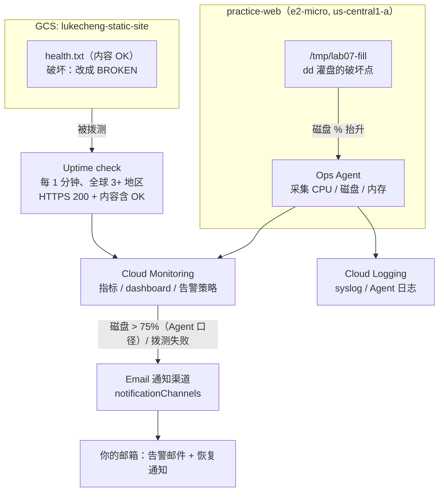

# 练习 7 · 监控告警日志（Cloud Monitoring + Logging + Uptime）

> 路线图第 7 项。**目标**：配好一个 dashboard、两条告警、一个可用性拨测，然后**真触发一次、真收到邮件**。  
> 沿用练习 1 的 VM + 练习 3 的 GCS 桶，**不新建任何计费资源**，全程在免费额度内。  
> 铁律：先跑通 → 再故意破坏 → 自己定位 → 修复 → 立刻拆掉监控配置（VM 保留给练习 1）。  
> 素材来自练习 6 的真实事故：RTO **37 分 26 秒**，会作为 dashboard 的第一块面板，用来讲「监控把『发现』这一段自动化」。  
> **被管理机器台账见根目录 [`MANAGED_HOSTS.md`](../MANAGED_HOSTS.md)**；真实生产机（`jump-us` / 主力 n8n）的混合云纳管见下方「扩展」章，  
> 那台是腾讯云机器，**不参与破坏演练**，本练习主线 0~5 步只打 `practice-web`。

---

## 🟢 当前状态：干净起点（2026-11-09 21:00 清场完毕，等你手敲一遍）

| 位置                     | 已清空的东西                                                                                                                                                                  | 复核命令                                                                                                                  |
| ---------------------- | ----------------------------------------------------------------------------------------------------------------------------------------------------------------------- | --------------------------------------------------------------------------------------------------------------------- |
| GCP 项目 `lukechengtest` | dashboard `prod-n8n-overview`、告警 `prod-n8n-health-failed` / `prod-n8n-host-degraded`、拨测 `prod-n8n-health`、服务账号 `hybrid-ops-agent`（含 key 和 IAM 绑定）                       | `gcloud monitoring dashboards list` / `policies list` / `uptime list-configs` / `iam service-accounts list` 全空或只剩默认账号 |
| 生产机 `jump-us`          | Ops Agent 2.73.0 包与 repo、`/opt/hybrid-metrics`（含 venv）、`hybrid-metrics.{service,timer}`、凭证 `/etc/google/auth/`、`/etc/systemd/system.conf` 的 `DefaultEnvironment` 行、安装脚本 | `rpm -qa \| grep google-cloud-ops` 无、`systemctl list-units --all \| grep -E 'hybrid\|ops-agent'` 无                    |
| 通知渠道                   | 项目里本来就没有（`lab07-email` / `prod-email` 都未建）                                                                                                                              | REST GET `notificationChannels` = 空                                                                                   |
| **没动**                 | `n8n-core` / `n8n-postgres` / `n8n-caddy` 三容器、Caddy、squid、Hysteria2、GCS 桶、`practice-web`                                                                                | `docker ps` 三个都 Up、`/healthz` = `{"status":"ok"}`                                                                     |

> 之前跑通的那轮是**验证方案可行**，已经拆干净；这轮由你从零敲一遍，把每一步的现象亲手认出来。  
> 云上残留的 5 个 `custom.googleapis.com/host/*` 指标**定义**不用管（API 不支持手删、也没数据写入就不计费），  
> 手敲后新点会继续写进同名指标。

## 手敲一遍速查（约 1.5 小时，两条线按顺序）

### 开工三件事（每个新终端窗口都要重敲）

```bash
cd ~/gcp-ops-labs/07-monitoring-alerting
export PROJECT=lukechengtest ZONE=us-central1-a VM=practice-web
export EMAIL='你想收告警的邮箱'        # ← 先定这个！A、B 两条线都要用
export http_proxy=http://127.0.0.1:7897 https_proxy=http://127.0.0.1:7897 \
       HTTP_PROXY=http://127.0.0.1:7897 HTTPS_PROXY=http://127.0.0.1:7897
export HOST_IP=$(gcloud compute instances describe $VM --zone=$ZONE \
  --format='value(networkInterfaces[0].accessConfigs[0].natIP)')
G() { gcloud "$@"; }
SSH() { ssh -i ~/.ssh/google_compute_engine -o StrictHostKeyChecking=no \
  -o UserKnownHostsFile=/dev/null -o ConnectTimeout=8 -o BatchMode=yes \
  lukecheng@$HOST_IP "$@"; }
echo "HOST_IP=$HOST_IP EMAIL=$EMAIL"
```

### A 线 · 练习 7 主线（约 50 分钟，只打 `practice-web`）

| #   | 照敲                                            | ✅ 过了再往下                                       |
| --- | --------------------------------------------- | --------------------------------------------- |
| A1  | 第 0.1 步 造 `health.txt`                        | `curl` 输出 `OK`                                |
| A2  | 第 0.2 步 建 `lab07-email` 通道                    | `echo $CHANNEL_ID` 有值                         |
| A3  | 第 0.3 步 装 Ops Agent                           | `systemctl is-active` = `active`              |
| A4  | 第 1 步 dashboard（**`--validate-only` 后再真建一次**） | `dashboards list` 出现 `lab07-*`                |
| A5  | 第 2 步 uptime check                            | `uptime list-configs` 出现 `lab07-health-check` |
| A6  | 第 3 步 两条告警                                    | `policies list` 两条 `enabled=True`             |
| A7  | 第 4.1 步 `dd` 灌 9G → 等 **2~4 分钟**              | 收到告警邮件 + `alerts list` 有 OPEN                 |
| A8  | 第 4.1 步 删填充文件                                 | 收到自动恢复通知                                      |
| A9  | 第 4.2 步 `OK`→`BROKEN`→`OK`                    | 再收一对触发/恢复邮件，曲线掉 0 再回 1                        |
| A10 | 第 5 步 三轮破坏-修复                                 | 曲线 / 事件 / 日志三处能对上                             |
| A11 | 「收尾：一键清理」                                     | `lab07-*` 清空（B 线资源此时还没建）                      |

### B 线 · 混合云纳管（约 40 分钟，扩展章 B0~B6，A 线跑完再开）

| #  | 照敲                                        | ✅ 过了再往下                                                                                                |
| -- | ----------------------------------------- | ------------------------------------------------------------------------------------------------------ |
| B0 | 扩展章 B0：确认干净起点、定 `EMAIL`                   | 上面那张清零表复核全过                                                                                            |
| B1 | B1：建服务账号 + 授两角色 + 发 key 传到 `jump-us`      | 凭证 `0400 root:root`，本地临时 key 删掉                                                                        |
| B2 | B2：凭证落位 + systemd `DefaultEnvironment`    | 凭证 `0400 root:root`、`system.conf` 有那行；B3 后可用 `systemctl show google-cloud-ops-agent -p Environment` 复核 |
| B3 | B3：装 Ops Agent（**只留日志**）                  | syslog 进 Cloud Logging                                                                                 |
| B4 | B4：部署 `hybrid/` 采集 + 60s timer            | 首次 `wrote 5 series`                                                                                    |
| B5 | B5：三链路验证                                  | 5 个自定义指标各有点、`generic_node` 标签对                                                                         |
| B6 | B6：拨测 + dashboard + 两条告警 + 绑 `prod-email` | 控制台四条资源齐、能收信                                                                                           |

> **时间大头是等**：告警邮件每轮 2~4 分钟，指标入库约 2 分钟。别因为没立刻出结果就重配。  
> **跑不完也要收尾**：先跑 A 线「一键清理」，再跑文档末尾「完整归零」，两段合起来 = 完全回到干净起点。  
> 别让云上资源过夜。

---

## 架构



## 开工前：干净起点复核（2026-11-09 21:00 清场后实测）

| 项                            | 实际值                                                                    | 对练习的意义                             |
| ---------------------------- | ---------------------------------------------------------------------- | ---------------------------------- |
| 项目                           | `lukechengtest`                                                        | 练习 1/3/6 同一个项目                     |
| VM                           | `practice-web` / e2-micro / `us-central1-a` / `35.194.5.128` / RUNNING | **直接复用**，免费额度只有 1 台 e2-micro，不要新建  |
| 服务账号 scopes                  | 含 `monitoring.write` + `logging.write`                                 | Ops Agent 装上就能写指标，**不用停机改 scopes** |
| Ops Agent（靶机）                | **未安装**                                                                | 第 0.3 步要装                          |
| Ops Agent（生产机）               | **已卸载**，包 / repo / 配置 / 凭证全清                                           | B 线 B3 要重装                         |
| 防火墙                          | `allow-http`（tag `http-server`，80/443）、`default-allow-ssh`（22）         | 已够用                                |
| 根盘（靶机）                       | 20GB，实测起点 44%（`df -h /` = 8.1G/20G）                                  | dd 灌到 df ~84% → Agent 指标 ~79.7%，越过 75% 阈值 |
| 根盘（生产机）                      | 40GB，已用 31%                                                            | **不准灌盘**，只做只读巡检                    |
| GCS 桶                        | `gs://lukecheng-static-site`，`index.html` 返回 200                       | 拨测目标用桶里的 `health.txt`，不动站点主页       |
| API                          | `monitoring` / `logging` / `compute` 均已启用                              | 不用再 enable                         |
| 通知渠道 / 告警策略 / 拨测 / dashboard | **全空**（上一轮实装已删）                                                        | 干净起点，练完删干净即可                       |
| 专用服务账号                       | `hybrid-ops-agent` **已删除**                                             | B 线 B1 要重建并重新发 key                 |
| `hybrid-metrics` 采集          | timer / service / `/opt/hybrid-metrics` **全清**                         | B 线 B4 要重新部署                       |

开工前跑一遍，四条都应为空（`service-accounts` 只剩系统默认的那几个）：

```bash
G monitoring dashboards list; G monitoring policies list
G monitoring uptime list-configs; G iam service-accounts list --format='value(email)'
ssh jump-us 'rpm -qa | grep -i google-cloud-ops; \
  systemctl list-units --all --no-pager | grep -iE "hybrid|ops-agent"; \
  docker ps --format "{{.Names}} {{.Status}}"; curl -fsS http://127.0.0.1:5678/healthz'
```

> VM 的 80 端口现在跑着 Caddy（练习 2 遗留），访问 `/` 会 308 跳 HTTPS、HTTPS 还报 TLS 错，  
> **不能拿来当拨测目标**。所以拨测走 GCS 的独立 `health.txt`，跟 VM 上的服务彻底解耦。

## 变量与两个工具函数（每个新窗口都要重敲）

```bash
cd ~/gcp-ops-labs/07-monitoring-alerting
export PROJECT=lukechengtest ZONE=us-central1-a VM=practice-web
export EMAIL='lukecheng1982@gmail.com'      # 换成你想收告警的邮箱
export HOST_IP=$(gcloud compute instances describe $VM --zone=$ZONE \
  --format='value(networkInterfaces[0].accessConfigs[0].natIP)')
echo "HOST_IP=$HOST_IP"

G() { gcloud "$@"; }                        # 代理已 export 到 7897 时透传即可
SSH() { ssh -i ~/.ssh/google_compute_engine -o StrictHostKeyChecking=no \
  -o UserKnownHostsFile=/dev/null -o ConnectTimeout=8 -o BatchMode=yes \
  lukecheng@$HOST_IP "$@"; }
```

> **本机实测坑**：`gcloud compute ssh` 在这台 Mac 上（走 Clash）会卡住，`--plain` 又会去问 root 密码；  
> 但 22 端口直连是通的。所以统一用上面的 `SSH()` 走 `~/.ssh/google_compute_engine` 密钥直连，实测可用。  
> 代理变量（`http_proxy` 等四组，端口 7897）只影响 gcloud 的 API 调用，不影响这条 SSH。

---

## 第 0 步 · 三件准备工作（约 10 分钟）

### 0.1 造拨测目标（独立于站点主页）

```bash
printf 'OK\n' > /tmp/lab07-health.txt
gcloud storage cp /tmp/lab07-health.txt gs://lukecheng-static-site/health.txt \
  --cache-control='no-store'
curl -sS --noproxy '*' -m 10 https://storage.googleapis.com/lukecheng-static-site/health.txt
# 应输出 OK
```

> `no-store` 很关键：GCS 边缘缓存会让内容匹配延迟 1~2 个周期才反映破坏/修复。  
> 破坏时只改这个对象，**不动权限、不动 index.html**，比练习 3 的 IAM 演练安全得多。

### 0.2 建邮件通知渠道（本机走 REST，不用 beta 组件）

```bash
TOKEN=$(gcloud auth print-access-token)
sed "s/__EMAIL__/$EMAIL/" notification-channel.json > /tmp/lab07-channel.json
curl -sS -X POST \
  -H "Authorization: Bearer $TOKEN" -H 'Content-Type: application/json' \
  --data-binary @/tmp/lab07-channel.json \
  "https://monitoring.googleapis.com/v3/projects/$PROJECT/notificationChannels" \
  | tee /tmp/lab07-channel-out.json
export CHANNEL_ID=$(python3 -c "import json,sys;print(json.load(sys.stdin)['name'].split('/')[-1])" \
  < /tmp/lab07-channel-out.json)
echo "CHANNEL_ID=$CHANNEL_ID"
```

> 为什么不用 `gcloud beta monitoring channels create`：本机 gcloud 591 没装 beta/alpha 组件，  
> 自动安装被代理的 SSL 打断。REST 直连 `monitoring.googleapis.com` 一把过，也不改本机 SDK。  
> 备用方案：控制台 Monitoring → Alerting → Edit notification channels → Email 手动加，  
> 然后用 `gcloud beta monitoring channels list`（若可用）或 REST GET 取 ID。

### 0.3 给 VM 装 Ops Agent

```bash
G services enable monitoring.googleapis.com logging.googleapis.com --project=$PROJECT
SSH 'curl -sSO https://dl.google.com/cloudagents/add-google-cloud-ops-agent-repo.sh \
  && sudo bash add-google-cloud-ops-agent-repo.sh --also-install'
SSH 'systemctl is-active google-cloud-ops-agent; df -h / | tail -1'
# 期望 active，40% 左右
```

> 换了项目/自建 VM 时先查 scopes：`gcloud compute instances describe ... --format='value(serviceAccounts[].scopes)'`，  
> 缺 `monitoring.write` 会「装上了但指标不出现」，且改 scopes 要停机。


---

## 第 1 步 · dashboard（约 3 分钟）

```bash
G monitoring dashboards create --config-from-file=dashboard.json --validate-only   # 先验证
G monitoring dashboards create --config-from-file=dashboard.json
G monitoring dashboards list --format='table(name,displayName)'
```

四块面板：

1. **练习 6 事故复盘（文字面板）**：37m26s 的 RTO 分项表 —— 等 WAL 窗口 4m24s / 人工决策 4m34s / clone 26m59s / 验证 1m28s。这块就是本练习的「为什么要有监控」：练习 6 里「发现 + 决策」全靠人，练习 7 把它变成自动告警。
2. CPU 利用率：`compute.googleapis.com/instance/cpu/utilization`，**hypervisor 直接给，不装 Agent 也有**。
3. 根盘使用率：`agent.googleapis.com/disk/percent_used`（Ops Agent，单位 **0~100 的百分比**，不是 0~1）。
4. Uptime 检查结果：`monitoring.googleapis.com/uptime_check/check_passed`，1=通过 / 0=失败。

> `--validate-only` 会打印 `Created [xxxx]`，**但并不会真的保存**（本机实测：跑完 `dashboards list` 仍为空）。  
> 别被这行输出骗了，真正创建要跑第二条命令。

## 第 2 步 · Uptime check（约 3 分钟）

```bash
G monitoring uptime create lab07-health-check \
  --resource-type=uptime-url \
  --resource-labels=host=storage.googleapis.com,project_id=$PROJECT \
  --protocol=https --port=443 \
  --path=/lukecheng-static-site/health.txt \
  --matcher-content=OK --matcher-type=contains-string \
  --period=1 --timeout=10

G monitoring uptime list-configs --format='table(name,displayName)'
```


> `--period=1` 是最小值（1 分钟），为了快点看到破坏效果。`--matcher-content=OK`  
> 让「返回 200 但内容被改坏」也算失败——这是内容级健康检查，比只看状态码更接近真实业务。  
> 地区默认全部（≥3 个），不用自己列。

## 第 3 步 · 两条告警策略（约 3 分钟）

```bash
G monitoring policies create --policy-from-file=alert-disk.json \
  --notification-channels="$CHANNEL_ID"
G monitoring policies create --policy-from-file=alert-uptime.json \
  --notification-channels="$CHANNEL_ID"
G monitoring policies list --format='table(name,displayName,enabled)'
```


| 策略                          | 条件                             | 为什么这么配                                     |
| --------------------------- | ------------------------------ | ------------------------------------------ |
| `lab07-disk-used-high`      | Ops Agent 磁盘 used > **75%**，持续 60s | 阈值要对齐 Agent 指标口径（比 `df` 低约 4 点），不是对齐 df；60s 是采样周期，别设更短 |
| `lab07-uptime-check-failed` | `check_passed` 失败计数 > 1，持续 60s | `REDUCE_COUNT_FALSE` 汇总各地区；多地区都失败才告警，抗单点抖动 |

> 渠道 ID 用 `--notification-channels` 从命令行注入，所以 JSON 里不用写死 ID。  
> 项目里只有一台 VM / 一条拨测，filter 故意不带 `instance_id` / `check_id`，文件可以直接复用。  
> **若 API 报 filter 语法错**：把 `metric.labels.state` 换成 `metric.label.state`（官方示例里单复数两种写法都出现过，  
> filters 文档规定复数，告警示例常用单数）。

## 第 3.5 步 · 会读日志定位（交付物之一）

```bash
G logging read 'resource.type="gce_instance"' --limit=10 --freshness=30m \
  --format='table(timestamp,logName,textPayload)'
G monitoring alerts list --filter='state=OPEN' --limit=5    # 默认 YAML 输出，字段名不用猜
```

> 指标告诉你「出事了」，日志告诉你「谁干的」。练习 6 里 pgAudit 日志就是干这个用的；  
> 本练习里对应的是 VM syslog（Ops Agent 启停、`dd` 写盘）和告警事件列表。

---

## 第 4 步 · 真触发一次，收邮件（本练习的核心交付物）

### 4.1 磁盘告警

```bash
SSH 'df -h / | tail -1'                       # 记起点：实测 44%
SSH 'sudo dd if=/dev/zero of=/tmp/lab07-fill bs=1M count=9000 status=progress'
SSH 'df -h / | tail -1'                       # 期望 df ~84%
```

> **别等 dd 跑完**：实测这台盘只有 ~10 MB/s，9G 要 15 分钟；`df` 到 84% 时已经越过阈值，直接 Ctrl-C 停掉。
> **收尾顺序必须是先停 dd、再删文件**，否则 dd 还握着文件句柄，空间不释放、告警也不会恢复。**别超过 90%**，灌满会让 VM 无法写日志、SSH 都可能出问题。

> ⚠️ **`df` 和告警看的不是同一个数**（2026-11-09 实测踩到）：Ops Agent 的 `agent.googleapis.com/disk/percent_used`（`state=used`）
> **不含 reserved blocks**，比 `df -h` 低约 4 个点。实测 `df -h /` = 84% 时，指标只有 **79.7%** —— 阈值写 80 就永远不触发，
> 表现是「盘都快满了却一封邮件都没有、`alerts list` 一直是 0」。所以 `alert-disk.json` 阈值定 **75**，对齐真实指标口径。
> 自己看真实数值（注意 `timeSeries` 返回的点按时间倒序，要自己排序）：

```bash
curl -s -G -H "Authorization: Bearer $(gcloud auth print-access-token)" \
  --data-urlencode 'filter=metric.type="agent.googleapis.com/disk/percent_used" AND metric.labels.state="used"' \
  --data-urlencode "interval.startTime=$(date -u -v-15M '+%Y-%m-%dT%H:%M:%SZ')" \
  --data-urlencode "interval.endTime=$(date -u '+%Y-%m-%dT%H:%M:%SZ')" \
  "https://monitoring.googleapis.com/v3/projects/$PROJECT/timeSeries" \
  | python3 -c "import json,sys;d=json.load(sys.stdin);[print(s['metric']['labels']['device'],round(sorted(s['points'],key=lambda p:p['interval']['startTime'])[-1]['value']['doubleValue'],1)) for s in d.get('timeSeries',[])]"
```

> Ops Agent 每 60s 采一次，告警 duration 60s → 越线后 **2~4 分钟收邮件**；期间去 dashboard 看曲线抬升。

确认告警开了：

```bash
G monitoring alerts list --filter='state=OPEN' --limit=5
```

> **收不到邮件先别重配**（2026-11-09 实测）：
> ① email 通道**不需要点验证链接** —— REST GET 里没有 `verificationStatus` 字段，即该类型无需验证、`enabled=true` 就能发。
> ② 发件方是 `alerting-noreply@google.com`，163 / QQ 这类邮箱容易丢进**垃圾箱 / 广告邮件**，先加白名单再翻一遍。
> ③ 通知只在事件**状态变化**时发（OPEN 一封、CLOSED 一封），**持续 OPEN 不会反复发**；想重收必须先让事件关闭，或换一条策略触发。
> ④ 云上确认链路通没通，看 `monitoring.googleapis.com%2FViolationOpenEventv1` 日志里有没有 `terse_message`（有 = 告警引擎确实开了，剩下只是投递）。

修复（会收到自动恢复通知，`autoClose=1800s`）：

```bash
SSH 'sudo rm -f /tmp/lab07-fill; df -h / | tail -1'
```

### 4.2 Uptime 告警

```bash
printf 'BROKEN\n' > /tmp/lab07-health.txt
gcloud storage cp /tmp/lab07-health.txt gs://lukecheng-static-site/health.txt \
  --cache-control='no-store'
# 等 2~4 分钟，看 dashboard 的 check_passed 掉到 0，收告警邮件

printf 'OK\n' > /tmp/lab07-health.txt
gcloud storage cp /tmp/lab07-health.txt gs://lukecheng-static-site/health.txt \
  --cache-control='no-store'
# 等 2~4 分钟，check_passed 回 1，收恢复通知
```

> 内容不匹配（`BROKEN` 不含 `OK`）= 拨测失败，这是**故意的软故障**：不改权限、不删对象、不停服务，  
> 秒级可回滚。收件箱里除了告警邮件，还要留一张 dashboard 截图当作品集证据。

## 第 5 步 · 破坏-修复演练（自己敲、自己定位）

| # | 破坏                                                        | 观察什么                                                                      | 修复                                            |
| - | --------------------------------------------------------- | ------------------------------------------------------------------------- | --------------------------------------------- |
| 1 | `SSH 'sudo systemctl stop google-cloud-ops-agent'`        | **磁盘曲线断档，但 CPU 曲线还在** —— 因为 CPU 来自 hypervisor，磁盘来自 Agent。这是理解「指标来源」最直观的一刀 | `sudo systemctl start google-cloud-ops-agent` |
| 2 | 把 `alert-disk.json` 阈值改成 `99`，或把 duration 改成 `600s` 再更新策略 | 灌到 84% 却不告警 → 体会阈值/持续时间对 MTTD 的影响                                         | 改回 75 / 60s                                   |
| 3 | 拨测 `--matcher-content` 改成 `NEVER_MATCH`（或删掉 health.txt）   | 内容匹配失败 / 404 都会让 `check_passed` 掉 0，但**故障指纹不同**（后者在 Logging 里能看到 404）     | 改回 `OK` / 重新上传                                |

> 按路线图约定：破坏环节只给骨架和排错方向，命令自己敲、现象自己认。  
> 排错顺序固定：**先看 dashboard 曲线 → 再看 `monitoring alerts list` → 最后翻 Cloud Logging**。

---

## 扩展 · 混合云纳管：主力 n8n 从零手敲（常驻，不参与破坏演练）

`jump-us` 是主力 n8n + GCP 操作跳板机：腾讯云轻量 `lhins-js6lgbt` / `na-ashburn` / `43.165.125.114` /  
Rocky Linux 9.4 / 域名 `cloudworkflowdone.com`，跑 `n8n-core` / `n8n-postgres` / `n8n-caddy`，  
兼任跳板机（squid `127.0.0.1:3128` + Hysteria2）。**2026-11-21 到期**。完整卡片见 `MANAGED_HOSTS.md`。

> **当前未部署** —— 上一轮只为验证方案可行，跑通后已全部拆除（见顶部「干净起点」）。  
> 下面 **B0 → B6** 是给手敲用的完整步骤，按顺序敲一遍就能把这台腾讯云机器接回同一个 GCP 项目。  
> 实现细节、排错、卸载见 [`hybrid/README.md`](hybrid/README.md)。

### 目标架构：三条链路汇到同一个项目

| 数据                       | 采集方                                              | 落点                                                    |
| ------------------------ | ------------------------------------------------ | ----------------------------------------------------- |
| syslog                   | Ops Agent 2.73.0（Fluent Bit，默认 logging pipeline） | Cloud Logging，`generic_node`                          |
| CPU / 内存 / 根盘 / 负载 / 容器数 | `hybrid-metrics` 每 60s                           | `custom.googleapis.com/host/*` on `generic_node`      |
| 站点可用性                    | 外部 uptime check                                  | `monitoring.googleapis.com/uptime_check/check_passed` |

**为什么内置指标不能用（你敲到 B3 会亲眼看到，别当成装失败了）**：`practice-web` 是 GCE，  
VM 自带服务账号，`agent.googleapis.com/*` 指标直接挂 `gce_instance`。这台腾讯云机器没有  
GCE metadata，Ops Agent 会退化到 `generic_node`，而内置指标**绑定 `gce_instance`**，  
Cloud Monitoring 以 `unknown metric type` 拒收。

上一轮实测：Agent 装上、凭证有效、日志正常入库，但 200 个指标点里 195 个被拒，  
CPU / 内存 / 磁盘 **0 条入库**。解法是按官方文档关掉内置 host metrics、保留日志 pipeline，  
系统指标改由自建脚本写成**自定义指标**（自定义指标允许挂 `generic_node`）。  
`generic_node` 标签：`node_id=jump-us` / `namespace=tencentcloud-na-ashburn` / `location=global`。

> `location` 只能填 GCP 区域名或 `global`，填腾讯云的 `na-ashburn` 会被  
> `Unrecognized region or location` 拒收。云厂商/区域放 `namespace`。

拨测目标选 `https://cloudworkflowdone.com/healthz`：`200` + `{"status":"ok"}`。  
它虽然走在 Cloudflare 后面，但响应头是 `cf-cache-status: DYNAMIC`（**不缓存**），  
源站挂了会真实失败，不会出现「源站死了 CF 还返缓存 200」的假绿；绕开 CF 直连  
`43.165.125.114` 的 `/healthz` 同样返回 200。

### B0 · 前提（1 分钟）

- `EMAIL` 已定（速查章「开工三件事」），B6 会用同一个地址建 `prod-email`。
- 复核顶部「干净起点」表：`dashboards / policies / uptime / 专用 SA` 全空、生产机无 Agent 残留。
- 生产机只做**安装类**操作，不碰三个容器、Caddy、squid、Hysteria2。

### B1 · GCP 侧：建最小权限服务账号 + 发 key（Mac）

```bash
SA="hybrid-ops-agent@$PROJECT.iam.gserviceaccount.com"
G iam service-accounts create hybrid-ops-agent \
  --display-name="Hybrid Ops Agent (jump-us)" --project=$PROJECT
for R in roles/monitoring.metricWriter roles/logging.logWriter; do
  G projects add-iam-policy-binding $PROJECT \
    --member="serviceAccount:$SA" --role="$R" --quiet
done
KEY=/tmp/hybrid-ops-agent-key.json
umask 077
G iam service-accounts keys create "$KEY" --iam-account="$SA" --project=$PROJECT
scp "$KEY" jump-us:/root/.hybrid-key.tmp.json
rm -f "$KEY"                                    # 本地临时副本立刻删
G projects get-iam-policy $PROJECT --flatten='bindings[].members' \
  --filter="bindings.members:$SA" --format='value(bindings.role)'
```

> ✅ 判定：最后一条输出两个角色；`ssh jump-us 'ls -l /root/.hybrid-key.tmp.json'` 有文件，本地 `/tmp` 里没有。  
> **仓库、文档、截图里不许出现 key 内容**。这台机器 11-21 到期，迁移时重新发一把、旧的删掉。

### B2 · 生产机：凭证落位 + 注入 systemd（root）

```bash
ssh jump-us 'set -e
mkdir -p /etc/google/auth; chmod 0700 /etc/google/auth
mv /root/.hybrid-key.tmp.json /etc/google/auth/application_default_credentials.json
chown root:root /etc/google/auth/application_default_credentials.json
chmod 0400 /etc/google/auth/application_default_credentials.json
if ! grep -q GOOGLE_APPLICATION_CREDENTIALS /etc/systemd/system.conf; then
  printf "%s\n" "DefaultEnvironment=\"GOOGLE_APPLICATION_CREDENTIALS=/etc/google/auth/application_default_credentials.json\"" >> /etc/systemd/system.conf
fi
systemctl daemon-reload
ls -l /etc/google/auth/application_default_credentials.json
grep DefaultEnvironment /etc/systemd/system.conf'
```

> ✅ 判定：权限 `-r-------- 1 root root`，且 `system.conf` 有那一行。  
> 为什么要写 `system.conf`：Ops Agent 是 systemd 服务，你在 shell 里 `export` 的变量它拿不到。

### B3 · 生产机：装 Ops Agent（只留日志）

```bash
ssh jump-us 'cd /root && curl -sSO https://dl.google.com/cloudagents/add-google-cloud-ops-agent-repo.sh \
  && bash add-google-cloud-ops-agent-repo.sh --also-install'
ssh jump-us 'systemctl is-active google-cloud-ops-agent-fluent-bit'
G logging read 'resource.type="generic_node"' --limit=3 --freshness=10m \
  --format='table(timestamp,logName)'
```

> 装完**先别急着看指标**：此刻内置指标正在刷 `failed to export metrics`，这是预期现象（原因见上）。  
> B4 会关掉它；日志侧这时候已经通了，第三条命令应能看到 syslog。

### B4 · 生产机：部署自定义指标采集（关内置指标 + 60s timer）

```bash
# 从 Mac，当前目录 07-monitoring-alerting
ssh jump-us 'mkdir -p /opt/hybrid-metrics'
scp hybrid/collect.py hybrid/hybrid-metrics.service hybrid/hybrid-metrics.timer \
    hybrid/ops-agent-config.yaml hybrid/README.md jump-us:/opt/hybrid-metrics/

ssh jump-us 'set -e
cd /opt/hybrid-metrics
cp hybrid-metrics.service hybrid-metrics.timer /etc/systemd/system/
cp ops-agent-config.yaml /etc/google-cloud-ops-agent/config.yaml
chmod 0644 collect.py
python3 -m venv /opt/hybrid-metrics/venv
/opt/hybrid-metrics/venv/bin/pip install -q --disable-pip-version-check \
  psutil google-auth requests -i https://mirrors.tencent.com/pypi/simple/
systemctl daemon-reload
systemctl restart google-cloud-ops-agent
systemctl enable --now hybrid-metrics.timer
systemctl start hybrid-metrics.service
sleep 2
journalctl -u hybrid-metrics.service -n 5 --no-pager | tail -5
systemctl list-timers hybrid-metrics.timer --no-pager | head -3'
```

> `cp ops-agent-config.yaml` 是**关键一刀**：把内置 `default_pipeline.receivers` 置空，日志 pipeline 保留。  
> 三个依赖一个都不能少 —— **`requests` 是 google-auth 的 transport 依赖，漏了直接 import 失败**。  
> ✅ 判定：日志出现 `wrote 5 series`；`hybrid-metrics.timer` = active/waiting。  
> 手动跑紧挨 timer 时报 `points ... too frequent` 是正常的**撞点**，脚本已做幂等跳过（打 WARN、返回 0），不是故障。

### B5 · 三链路验证（只读，别去停容器试）

```bash
TOKEN=$(gcloud auth print-access-token)
START=$(date -u -v-15M +%Y-%m-%dT%H:%M:%SZ); END=$(date -u +%Y-%m-%dT%H:%M:%SZ)
for M in cpu_utilization memory_utilization disk_used_percent load1 n8n_containers_up; do
  printf "%-24s " "$M"
  curl -sS -G -H "Authorization: Bearer $TOKEN" \
    --data-urlencode "filter=metric.type=\"custom.googleapis.com/host/$M\"" \
    --data-urlencode "interval.startTime=$START" --data-urlencode "interval.endTime=$END" \
    "https://monitoring.googleapis.com/v3/projects/$PROJECT/timeSeries" \
    | python3 -c "import json,sys;d=json.load(sys.stdin);t=d.get('timeSeries',[]);print('点数',sum(len(x.get('points',[])) for x in t),'|',(str(t[0]['resource']['labels']) if t else d.get('error',{}).get('message','无')))"
done
G logging read 'resource.type="generic_node"' --limit=3 --freshness=10m \
  --format='table(timestamp,logName)'
ssh jump-us 'systemctl is-active hybrid-metrics.timer; \
  journalctl -u hybrid-metrics.service --since "3 min ago" --no-pager | grep -E "wrote|WARN|ERROR" | tail -3; \
  curl -fsS http://127.0.0.1:5678/healthz'
```

> ✅ 判定：5 个指标**都有点**、`resource.type=generic_node` / `node_id=jump-us`；日志有 syslog；  
> timer = active、健康端点 `{"status":"ok"}`。指标首次入库约 1~2 分钟，别急着重装。

### B6 · 云上资源 + 常驻邮件通道（干净起点，一次建好不用重建）

```bash
# 1. 常驻邮件通道（REST：本机 gcloud 没装 beta 组件，理由同第 0.2 步）
TOKEN=$(gcloud auth print-access-token)
sed "s/__EMAIL__/$EMAIL/" notification-channel-production.json > /tmp/prod-channel.json
curl -sS -X POST \
  -H "Authorization: Bearer $TOKEN" -H 'Content-Type: application/json' \
  --data-binary @/tmp/prod-channel.json \
  "https://monitoring.googleapis.com/v3/projects/$PROJECT/notificationChannels" \
  | tee /tmp/prod-channel-out.json
export PROD_CHANNEL_ID=$(python3 -c "import json,sys;print(json.load(sys.stdin)['name'].split('/')[-1])" \
  < /tmp/prod-channel-out.json)
echo "PROD_CHANNEL_ID=$PROD_CHANNEL_ID"

# 2. 外部拨测：每 1 分钟，HTTPS 200 且内容含 ok
G monitoring uptime create prod-n8n-health \
  --resource-type=uptime-url \
  --resource-labels=host=cloudworkflowdone.com,project_id=$PROJECT \
  --protocol=https --port=443 --path=/healthz \
  --matcher-content=ok --matcher-type=contains-string \
  --period=1 --timeout=10

# 3. 两条告警，一次就把通道绑上（干净起点，不用先建再删）
G monitoring policies create --policy-from-file=alert-uptime-production.json \
  --notification-channels="$PROD_CHANNEL_ID"
G monitoring policies create --policy-from-file=alert-host-production.json \
  --notification-channels="$PROD_CHANNEL_ID"

# 4. 常驻 dashboard（不混进练习那张，曲线不会被演练污染）
G monitoring dashboards create --config-from-file=dashboard-production.json
```


> **不要复用练习 7 的 `lab07-email`** —— A11 收尾会 DELETE 掉它，生产告警就跟着哑了。  
> `prod-email` 是常驻资源，练习收尾只删 `lab07-email`。  
> `alert-uptime-production.json` 用 `resource.labels.host = "cloudworkflowdone.com"` 把范围钉死，  
> 所以练习 7 破坏 `health.txt` 时**不会误报生产机**，反过来也一样。

### B6 完成后应达到的状态

| 资源        | 名称                                 | 期望                                  |
| --------- | ---------------------------------- | ----------------------------------- |
| 拨测        | `prod-n8n-health`                  | 每 1 分钟，`check_passed` = 1           |
| 告警        | `prod-n8n-health-failed`           | enabled，已绑 `prod-email`             |
| 告警        | `prod-n8n-host-degraded`           | enabled，5 条件（含采集断档），已绑 `prod-email` |
| Dashboard | `prod-n8n-overview`                | 四面板（系统指标 / 容器数+拨测 / 纳管说明 / 负载）      |
| 邮件通道      | `prod-email`                       | 地址 = `$EMAIL`，与 `lab07-email` 分开    |
| 指标        | 5 个 `custom.googleapis.com/host/*` | 各有点，`node_id=jump-us`               |

```bash
G monitoring uptime list-configs --format='table(displayName,name)'
G monitoring policies list --format='table(displayName,enabled)'
G monitoring dashboards list --format='table(displayName,name)'
curl -sS --noproxy '*' -m 10 https://cloudworkflowdone.com/healthz   # {"status":"ok"}
```

> 想看真触发，只做只读观测：等自然故障，或在控制台里临时停掉这条拨测再恢复（**不要动 n8n**）。

### 主机告警的五个条件

根盘 >85% / CPU >90% / 内存 >90% / n8n 容器数 <3 / **采集断档 >5 分钟**。  
最后一条最要紧：采集自己挂了之后，前四条阈值告警全都不会响，别误以为一切正常。  
`n8n_containers_up = -1` 表示 `docker ps` 查询失败，也会触发「容器数 < 3」。

### 红线

- **生产机不参与破坏演练**：禁止 `dd` 灌盘、停容器、停 Agent、改 Caddy/squid 配置。  
  那台还兼着 GCP 操作的代理通道，弄断了后面所有练习都连不上。
- 只允许只读巡检：`ssh jump-us 'docker ps; df -h /; curl -fsS http://127.0.0.1:5678/healthz'`。
- 命名统一 `prod-` 前缀；A 线清理脚本按 `lab07-` 前缀过滤，**不会误删**这几条常驻配置。
- **凭证管理**：服务账号 key 只在生产机上（`0400 root:root`），仓库、文档、截图里都不许出现；  
  走下面「完整归零」时要顺手删 GCP 侧的 SA / key 和 systemd 的 `DefaultEnvironment` 行。
- **手敲前别跳过 B1**：上一轮清场把 `hybrid-ops-agent` 服务账号也删了，B3/B4 没凭证会直接 401。
- 到期前（**2026-11-21**）决定续费还是迁移；机器没了，拨测和指标采集都得在新机器上重做一遍。

---

## 免费红线与成本

- 不新建 VM（免费额度 1 台 e2-micro 已给 `practice-web`）、不建 LB、不建 Cloud SQL。
- GCP 自带指标、`uptime_url` 拨测、告警策略、邮件通道**都在免费额度内**；Ops Agent 写入的指标量很小。
- B 线那条 `prod-n8n-health` 是第二条拨测，同样在免费额度内；它常驻，不随 A 线练习清理。
- **注意**：生产机的 5 个 `custom.googleapis.com/host/*` 是**自定义指标，按样本量计费**（约 21.6 万点/月），  
  金额很小但不是零；在 Metrics Management 页可看实际用量。清场后没有数据写入，就不产生这部分费用。
- 唯一可能产生费用的是 GCS 对象存储和请求，`health.txt` 就几字节，可忽略。
- **A 线练完把 `lab07-*` 全删**（下一节）；**B 线想回到干净起点用「完整归零」**（再下一节）。  
  VM 和 GCS 桶始终保留给练习 1/3。

## 收尾：一键清理（别让配置过夜）

```bash
# 只删练习资源（lab07- 前缀）；prod-* 是常驻生产监控，必须保留
# 用 awk 按 displayName 前缀筛，不依赖 gcloud 的 --filter 字段名（空列表时会报 key 不存在）
# 告警策略
for p in $(G monitoring policies list --format='value(name,displayName)' | awk '$2 ~ /^lab07-/ {print $1}'); do
  G monitoring policies delete "$p" --quiet
done
# Uptime check（delete 收的是 CHECK_ID）
for u in $(G monitoring uptime list-configs --format='value(name,displayName)' | awk '$2 ~ /^lab07-/ {print $1}'); do
  G monitoring uptime delete "${u##*/}" --quiet
done
# Dashboard
for d in $(G monitoring dashboards list --format='value(name,displayName)' | awk '$2 ~ /^lab07-/ {print $1}'); do
  G monitoring dashboards delete "$d" --quiet
done
# 邮件通知渠道（REST DELETE）
curl -sS -X DELETE -H "Authorization: Bearer $(gcloud auth print-access-token)" \
  "https://monitoring.googleapis.com/v3/projects/$PROJECT/notificationChannels/$CHANNEL_ID"
# 拨测目标对象
gcloud storage rm gs://lukecheng-static-site/health.txt

# 确认：lab07-* 已清空（A 线先跑时 prod-* 尚未建立；若已跑过 B 线，prod-* 应仍在）
G monitoring policies list --format='table(displayName,enabled)'
G monitoring uptime list-configs --format='table(displayName)'
G monitoring dashboards list --format='table(displayName)'
```

> 跑之前先 `... list --format='table(name,displayName)'` 看一眼，确认 awk 只圈中了 `lab07-*`；  
> 名字拿不准就按 `name` 手动删，别把 `prod-*` 一起清了。  
> 末尾的 REST DELETE 只删 `$CHANNEL_ID`（练习那条）——**换新窗口要先重新 export `CHANNEL_ID`**，  
> 否则会删到一个空 ID；`prod-email` 是独立通道，不受影响。  
> 靶机上的 Ops Agent 可以留着（对练习 1 无害），想连靶机也回到完全干净起点就卸：  
> `SSH 'sudo bash add-google-cloud-ops-agent-repo.sh --uninstall'`。  
> **不要删 `practice-web`**，它是练习 1 的资产；也不要动 `index.html` 和 bucket 权限。

## 完整归零：把 B 线也拆回干净起点（想再手敲一遍就跑这个）

> 2026-11-09 21:00 就是用这段清的场。它只删**本次实验自己造的东西**，  
> n8n 三容器、Caddy、squid、Hysteria2、`practice-web`、GCS 桶一律不动。  
> **顺序**：先跑上一节 A 线「一键清理」（含 `health.txt` 和 `lab07-email`），再跑这段；  
> 两段合起来才是完全干净起点。只想重敲 B 线的话，单独跑这段就够。

```bash
# ── 1. 云上：只删 prod-* 与专用服务账号 ──────────────────────────
for p in $(G monitoring policies list --format='value(name,displayName)' | awk '$2 ~ /^prod-/ {print $1}'); do
  G monitoring policies delete "$p" --quiet
done
for u in $(G monitoring uptime list-configs --format='value(name,displayName)' | awk '$2 ~ /^prod-/ {print $1}'); do
  G monitoring uptime delete "${u##*/}" --quiet
done
for d in $(G monitoring dashboards list --format='value(name,displayName)' | awk '$2 ~ /^prod-/ {print $1}'); do
  G monitoring dashboards delete "$d" --quiet
done
# prod-email 通道（REST DELETE，按 displayName 找 ID）
TOKEN=$(gcloud auth print-access-token)
CH=$(curl -sS -H "Authorization: Bearer $TOKEN" \
  "https://monitoring.googleapis.com/v3/projects/$PROJECT/notificationChannels" \
  | python3 -c "import json,sys;print(next((c['name'].split('/')[-1] for c in json.load(sys.stdin).get('notificationChannels',[]) if c.get('displayName')=='prod-email'),''))")
[ -n "$CH" ] && curl -sS -X DELETE -H "Authorization: Bearer $TOKEN" \
  "https://monitoring.googleapis.com/v3/projects/$PROJECT/notificationChannels/$CH"
G iam service-accounts delete hybrid-ops-agent@$PROJECT.iam.gserviceaccount.com \
  --project=$PROJECT --quiet 2>/dev/null || echo '（SA 不存在，跳过）'

# ── 2. 生产机：停服务、卸包、删凭证、还原 systemd ────────────────
ssh jump-us 'set -e
systemctl disable --now hybrid-metrics.timer 2>/dev/null || true
systemctl stop google-cloud-ops-agent 2>/dev/null || true
systemctl disable google-cloud-ops-agent 2>/dev/null || true
dnf remove -y google-cloud-ops-agent >/dev/null 2>&1 || true
rm -f /etc/systemd/system/hybrid-metrics.service /etc/systemd/system/hybrid-metrics.timer
rm -rf /opt/hybrid-metrics /etc/google-cloud-ops-agent /etc/google/auth
rm -f /etc/yum.repos.d/google-cloud-ops-agent.repo /root/add-google-cloud-ops-agent-repo.sh
sed -i "/^DefaultEnvironment=.*GOOGLE_APPLICATION_CREDENTIALS/d" /etc/systemd/system.conf
systemctl daemon-reload
systemctl reset-failed hybrid-metrics.service 2>/dev/null || true'

# ── 3. 复核：左边全空，右边三个容器仍在 ──────────────────────────
G monitoring dashboards list; G monitoring policies list; G monitoring uptime list-configs
G iam service-accounts list --format='value(email)'
ssh jump-us 'rpm -qa | grep -i google-cloud-ops; \
  systemctl list-units --all --no-pager | grep -iE "hybrid|ops-agent"; \
  docker ps --format "{{.Names}} {{.Status}}"; curl -fsS http://127.0.0.1:5678/healthz'
```

> `custom.googleapis.com/host/*` 的**指标定义**不用删（API 不支持手删）；没有数据写入就不计费，  
> 下次手敲时新点会继续写进同名指标。删完再敲一遍，从速查章「开工三件事」开始即可。

## 最容易翻车的 14 条

| #  | 坑                                           | 正确做法                                                                                        |
| -- | ------------------------------------------- | ------------------------------------------------------------------------------------------- |
| 1  | 拿 VM 的 `/` 当拨测目标                            | 那里是 308 → HTTPS → TLS 错；走 GCS 的 `health.txt`                                                |
| 2  | 忘了 `--cache-control=no-store`               | 内容匹配延迟 1~2 周期，会以为告警没触发                                                                      |
| 3  | `gcloud compute ssh` 卡死 / `--plain` 问密码     | 用本文件的 `SSH()` 走 gcloud 密钥直连                                                                 |
| 4  | 装了 Agent 但指标不出来                             | 查 VM scopes 有没有 `monitoring.write`；本项目已确认有                                                  |
| 5  | 磁盘阈值写成 `0.8`，或照抄 `df` 写 `80`              | 该指标是 **0~100 百分比**；且比 `df` 低约 4 点，`df` 84% 时指标 79.7%，阈值写 `80` 永不触发 → 写 **`75`** |
| 6  | `--validate-only` 打印 `Created [...]` 就以为建好了 | 它只是校验；再跑一次不带该参数才真创建                                                                         |
| 7  | 灌盘灌到 100%                                   | 从 40% 起灌 9G 到 ~85% 就够，留 3G 给系统写日志                                                           |
| 8  | 告警配好立刻看邮件                                   | 采样 60s + duration 60s + 邮件投递，**2~4 分钟**才到，别急着重配                                             |
| 9  | 清理脚本一把删掉所有拨测/策略                             | 加了 `prod-*` 常驻监控后必须按 `lab07-` 前缀过滤；删了生产告警等于裸奔                                               |
| 10 | 告警策略里 `autoClose` 写 `600s`                  | **最少 30 分钟**，API 直接报 `INVALID_ARGUMENT`；两份 uptime 策略都写成 `1800s`                             |
| 11 | 非 GCE 机器装完 Ops Agent 以为有指标了                 | 内置 `agent.googleapis.com/*` 绑定 `gce_instance`，挂 `generic_node` 会被拒；必须改自定义指标，且采集链路本身要有「断档」告警 |
| 12 | 清场后从 B3 直接开敲                                | 上一轮把 `hybrid-ops-agent` 服务账号也删了，**必须先跑 B1 重建 SA 并发 key**，否则凭证缺失、指标写不进                       |
| 13 | 新窗口直接敲 `SSH ...` 报 `hostname contains invalid characters` | `SSH()` / `HOST_IP` 是上个窗口临时定义的，新窗口要重敲「开工三件事」；应急可直接写全 `ssh -i ~/.ssh/google_compute_engine ... lukecheng@<IP>` |
| 14 | 告警还 `OPEN` 时「再破坏一次」想重收邮件             | **持续 OPEN 不会重复发信**，通知只在状态变化（OPEN / CLOSED）时发。先删填充文件让事件关闭（收恢复信），再破坏才有新的触发信；想立刻测通道就走 4.2 的 uptime（另一条策略、全新事件） |

## 作品集交付物（跑完补进来）

- [ ] 告警邮件截图（含触发 + 恢复两封）
- [ ] dashboard 截图（四块面板，磁盘曲线有明显抬升、uptime 有掉 0 再回 1）
- [ ] `monitoring alerts list` 事件时间线（MTTD 实测：从破坏到告警开了多久）
- [ ] 「What I broke and how I fixed it」：三轮破坏的现象与定位过程
- [ ] 一段心得：**练习 6 的 37m26s RTO 里，4m34s 是纯人工决策；练习 7 的告警把「发现」自动化后，这段能压到多少**

## 文件

| 文件                                     | 用途                                                                      |
| -------------------------------------- | ----------------------------------------------------------------------- |
| `README.md`                            | 本 runbook                                                               |
| `dashboard.json`                       | 四面板 dashboard（含练习 6 RTO 复盘文字面板），已过 API `--validate-only`                |
| `alert-disk.json`                      | 磁盘 >75% 告警策略（对齐 Ops Agent 口径，见 4.1 步实测说明）                              |
| `alert-uptime.json`                    | Uptime 拨测失败告警策略                                                         |
| `notification-channel.json`            | 邮件通道模板（`__EMAIL__` 用 sed 替换）                                            |
| `alert-uptime-production.json`         | 主力 n8n 拨测失败告警（`prod-` 常驻，filter 锁 `cloudworkflowdone.com`）              |
| `dashboard-production.json`            | 生产机常驻 dashboard（四面板：系统指标 / 容器数+拨测 / 纳管说明 / 负载）                          |
| `notification-channel-production.json` | `prod-email` 常驻邮件通道模板（`__EMAIL__` 用 sed 替换），**与 `lab07-email` 分开**      |
| `alert-host-production.json`           | 生产机主机指标告警（5 条件，含采集断档）                                                   |
| `hybrid/`                              | **待部署**的跨云采集实现：`collect.py`、systemd service/timer、Ops Agent 覆盖配置、安装排错手册 |

> 上面全是**模板与手册，不是已建资源**。当前云上和两台机器都处于干净起点，照速查章敲一遍才会产生资源。

> 命令语法按本机 gcloud 591.0.0 的 `gcloud monitoring ... --help` 核准；  
> 指标名/单位核对自 [Ops Agent metrics](https://docs.cloud.google.com/monitoring/api/metrics_opsagent)，  
> 告警条件结构核对自 [Sample policies in JSON](https://cloud.google.com/monitoring/alerts/policies-in-json)。
