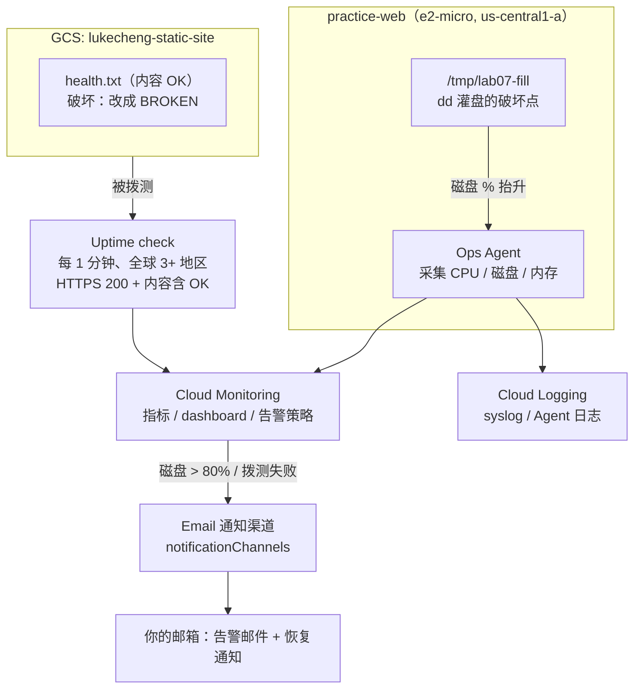

# 练习 7 · 监控告警日志（Cloud Monitoring + Logging + Uptime）

> 路线图第 7 项。**目标**：配好一个 dashboard、两条告警、一个可用性拨测，然后**真触发一次、真收到邮件**。
> 沿用练习 1 的 VM + 练习 3 的 GCS 桶，**不新建任何计费资源**，全程在免费额度内。
> 铁律：先跑通 → 再故意破坏 → 自己定位 → 修复 → 立刻拆掉监控配置（VM 保留给练习 1）。
> 素材来自练习 6 的真实事故：RTO **37 分 26 秒**，会作为 dashboard 的第一块面板，用来讲「监控把『发现』这一段自动化」。

## 架构



## 开工前：环境现状（2026-11-09 已核过）

| 项 | 实际值 | 对练习的意义 |
| --- | --- | --- |
| 项目 | `lukechengtest` | 练习 1/3/6 同一个项目 |
| VM | `practice-web` / e2-micro / `us-central1-a` / `35.194.5.128` / RUNNING | **直接复用**，免费额度只有 1 台 e2-micro，不要新建 |
| 服务账号 scopes | 含 `monitoring.write` + `logging.write` | Ops Agent 装上就能写指标，**不用停机改 scopes** |
| Ops Agent | **未安装**（`systemctl is-active` = inactive / 无 dpkg 记录） | 第 0 步要装 |
| 防火墙 | `allow-http`（tag `http-server`，80/443）、`default-allow-ssh`（22） | 已够用 |
| 根盘 | 20GB，**已用 40%**（`df -h /` = 7.5G/20G） | dd 灌到 ~85% 就能越过 80% 阈值 |
| GCS 桶 | `gs://lukecheng-static-site`，`index.html` 返回 200 | 拨测目标用桶里的 `health.txt`，不动站点主页 |
| API | `monitoring` / `logging` / `compute` 均已启用 | 不用再 enable |
| 通知渠道 / 告警策略 / 拨测 / dashboard | **全空** | 干净起点，练完删干净即可 |

> VM 的 80 端口现在跑着 Caddy（练习 2 遗留），访问 `/` 会 308 跳 HTTPS、HTTPS 还报 TLS 错，
> **不能拿来当拨测目标**。所以拨测走 GCS 的独立 `health.txt`，跟 VM 上的服务彻底解耦。

## 变量与两个工具函数（每个新窗口都要重敲）

```bash
cd ~/gcp-ops-labs/07-monitoring-alerting
export PROJECT=lukechengtest ZONE=us-central1-a VM=practice-web
export EMAIL='lukecheng1982@gmail.com'      # 换成你想收告警的邮箱
export HOST_IP=$(gcloud compute instances describe $VM --zone=$ZONE \
  --format='value(networkInterfaces[0].accessConfigs[0].natIP)')
echo "HOST_IP=$HOST_IP"

G() { gcloud "$@"; }                        # 代理已 export 到 7897 时透传即可
SSH() { ssh -i ~/.ssh/google_compute_engine -o StrictHostKeyChecking=no \
  -o UserKnownHostsFile=/dev/null -o ConnectTimeout=8 -o BatchMode=yes \
  lukecheng@$HOST_IP "$@"; }
```

> **本机实测坑**：`gcloud compute ssh` 在这台 Mac 上（走 Clash）会卡住，`--plain` 又会去问 root 密码；
> 但 22 端口直连是通的。所以统一用上面的 `SSH()` 走 `~/.ssh/google_compute_engine` 密钥直连，实测可用。
> 代理变量（`http_proxy` 等四组，端口 7897）只影响 gcloud 的 API 调用，不影响这条 SSH。

---

## 第 0 步 · 三件准备工作（约 10 分钟）

### 0.1 造拨测目标（独立于站点主页）

```bash
printf 'OK\n' > /tmp/lab07-health.txt
gcloud storage cp /tmp/lab07-health.txt gs://lukecheng-static-site/health.txt \
  --cache-control='no-store'
curl -sS --noproxy '*' -m 10 https://storage.googleapis.com/lukecheng-static-site/health.txt
# 应输出 OK
```

> `no-store` 很关键：GCS 边缘缓存会让内容匹配延迟 1~2 个周期才反映破坏/修复。
> 破坏时只改这个对象，**不动权限、不动 index.html**，比练习 3 的 IAM 演练安全得多。

### 0.2 建邮件通知渠道（本机走 REST，不用 beta 组件）

```bash
TOKEN=$(gcloud auth print-access-token)
sed "s/__EMAIL__/$EMAIL/" notification-channel.json > /tmp/lab07-channel.json
curl -sS -X POST \
  -H "Authorization: Bearer $TOKEN" -H 'Content-Type: application/json' \
  --data-binary @/tmp/lab07-channel.json \
  "https://monitoring.googleapis.com/v3/projects/$PROJECT/notificationChannels" \
  | tee /tmp/lab07-channel-out.json
export CHANNEL_ID=$(python3 -c "import json,sys;print(json.load(sys.stdin)['name'].split('/')[-1])" \
  < /tmp/lab07-channel-out.json)
echo "CHANNEL_ID=$CHANNEL_ID"
```

> 为什么不用 `gcloud beta monitoring channels create`：本机 gcloud 591 没装 beta/alpha 组件，
> 自动安装被代理的 SSL 打断。REST 直连 `monitoring.googleapis.com` 一把过，也不改本机 SDK。
> 备用方案：控制台 Monitoring → Alerting → Edit notification channels → Email 手动加，
> 然后用 `gcloud beta monitoring channels list`（若可用）或 REST GET 取 ID。

### 0.3 给 VM 装 Ops Agent

```bash
G services enable monitoring.googleapis.com logging.googleapis.com --project=$PROJECT
SSH 'curl -sSO https://dl.google.com/cloudagents/add-google-cloud-ops-agent-repo.sh \
  && sudo bash add-google-cloud-ops-agent-repo.sh --also-install'
SSH 'systemctl is-active google-cloud-ops-agent; df -h / | tail -1'
# 期望 active，40% 左右
```

> 换了项目/自建 VM 时先查 scopes：`gcloud compute instances describe ... --format='value(serviceAccounts[].scopes)'`，
> 缺 `monitoring.write` 会「装上了但指标不出现」，且改 scopes 要停机。

---

## 第 1 步 · dashboard（约 3 分钟）

```bash
G monitoring dashboards create --config-from-file=dashboard.json --validate-only   # 先验证
G monitoring dashboards create --config-from-file=dashboard.json
G monitoring dashboards list --format='table(name,displayName)'
```

四块面板：

1. **练习 6 事故复盘（文字面板）**：37m26s 的 RTO 分项表 —— 等 WAL 窗口 4m24s / 人工决策 4m34s / clone 26m59s / 验证 1m28s。这块就是本练习的「为什么要有监控」：练习 6 里「发现 + 决策」全靠人，练习 7 把它变成自动告警。
2. CPU 利用率：`compute.googleapis.com/instance/cpu/utilization`，**hypervisor 直接给，不装 Agent 也有**。
3. 根盘使用率：`agent.googleapis.com/disk/percent_used`（Ops Agent，单位 **0~100 的百分比**，不是 0~1）。
4. Uptime 检查结果：`monitoring.googleapis.com/uptime_check/check_passed`，1=通过 / 0=失败。

> `--validate-only` 会打印 `Created [xxxx]`，**但并不会真的保存**（本机实测：跑完 `dashboards list` 仍为空）。
> 别被这行输出骗了，真正创建要跑第二条命令。

## 第 2 步 · Uptime check（约 3 分钟）

```bash
G monitoring uptime create lab07-health-check \
  --resource-type=uptime-url \
  --resource-labels=host=storage.googleapis.com,project_id=$PROJECT \
  --protocol=https --port=443 \
  --path=/lukecheng-static-site/health.txt \
  --matcher-content=OK --matcher-type=contains-string \
  --period=1 --timeout=10

G monitoring uptime list-configs --format='table(name,displayName)'
```

> `--period=1` 是最小值（1 分钟），为了快点看到破坏效果。`--matcher-content=OK`
> 让「返回 200 但内容被改坏」也算失败——这是内容级健康检查，比只看状态码更接近真实业务。
> 地区默认全部（≥3 个），不用自己列。

## 第 3 步 · 两条告警策略（约 3 分钟）

```bash
G monitoring policies create --policy-from-file=alert-disk.json \
  --notification-channels="$CHANNEL_ID"
G monitoring policies create --policy-from-file=alert-uptime.json \
  --notification-channels="$CHANNEL_ID"
G monitoring policies list --format='table(name,displayName,enabled)'
```

| 策略 | 条件 | 为什么这么配 |
| --- | --- | --- |
| `lab07-disk-used-high` | Ops Agent 磁盘 used > 80%，持续 60s | 生产常用阈值；60s 是 Agent 采样周期，别设更短 |
| `lab07-uptime-check-failed` | `check_passed` 失败计数 > 1，持续 60s | `REDUCE_COUNT_FALSE` 汇总各地区；多地区都失败才告警，抗单点抖动 |

> 渠道 ID 用 `--notification-channels` 从命令行注入，所以 JSON 里不用写死 ID。
> 项目里只有一台 VM / 一条拨测，filter 故意不带 `instance_id` / `check_id`，文件可以直接复用。
> **若 API 报 filter 语法错**：把 `metric.labels.state` 换成 `metric.label.state`（官方示例里单复数两种写法都出现过，
> filters 文档规定复数，告警示例常用单数）。

## 第 3.5 步 · 会读日志定位（交付物之一）

```bash
G logging read 'resource.type="gce_instance"' --limit=10 --freshness=30m \
  --format='table(timestamp,logName,textPayload)'
G monitoring alerts list --filter='state=OPEN' --limit=5    # 默认 YAML 输出，字段名不用猜
```

> 指标告诉你「出事了」，日志告诉你「谁干的」。练习 6 里 pgAudit 日志就是干这个用的；
> 本练习里对应的是 VM syslog（Ops Agent 启停、`dd` 写盘）和告警事件列表。

---

## 第 4 步 · 真触发一次，收邮件（本练习的核心交付物）

### 4.1 磁盘告警

```bash
SSH 'df -h / | tail -1'                       # 记起点：约 40%
SSH 'sudo dd if=/dev/zero of=/tmp/lab07-fill bs=1M count=9000 status=progress'
SSH 'df -h / | tail -1'                       # 期望 ~85%
```

> 20G 盘从 40% 起，9G 大约抬 45 个点。**别超过 90%**，灌满会让 VM 无法写日志、SSH 都可能出问题。
> Ops Agent 每 60s 采一次，告警 duration 60s → **2~4 分钟后收邮件**；期间去 dashboard 看曲线抬升。

确认告警开了：

```bash
G monitoring alerts list --filter='state=OPEN' --limit=5
```

修复（会收到自动恢复通知，`autoClose=1800s`）：

```bash
SSH 'sudo rm -f /tmp/lab07-fill; df -h / | tail -1'
```

### 4.2 Uptime 告警

```bash
printf 'BROKEN\n' > /tmp/lab07-health.txt
gcloud storage cp /tmp/lab07-health.txt gs://lukecheng-static-site/health.txt \
  --cache-control='no-store'
# 等 2~4 分钟，看 dashboard 的 check_passed 掉到 0，收告警邮件

printf 'OK\n' > /tmp/lab07-health.txt
gcloud storage cp /tmp/lab07-health.txt gs://lukecheng-static-site/health.txt \
  --cache-control='no-store'
# 等 2~4 分钟，check_passed 回 1，收恢复通知
```

> 内容不匹配（`BROKEN` 不含 `OK`）= 拨测失败，这是**故意的软故障**：不改权限、不删对象、不停服务，
> 秒级可回滚。收件箱里除了告警邮件，还要留一张 dashboard 截图当作品集证据。

## 第 5 步 · 破坏-修复演练（自己敲、自己定位）

| # | 破坏 | 观察什么 | 修复 |
| --- | --- | --- | --- |
| 1 | `SSH 'sudo systemctl stop google-cloud-ops-agent'` | **磁盘曲线断档，但 CPU 曲线还在** —— 因为 CPU 来自 hypervisor，磁盘来自 Agent。这是理解「指标来源」最直观的一刀 | `sudo systemctl start google-cloud-ops-agent` |
| 2 | 把 `alert-disk.json` 阈值改成 `99`，或把 duration 改成 `600s` 再更新策略 | 灌到 85% 却不告警 → 体会阈值/持续时间对 MTTD 的影响 | 改回 80 / 60s |
| 3 | 拨测 `--matcher-content` 改成 `NEVER_MATCH`（或删掉 health.txt） | 内容匹配失败 / 404 都会让 `check_passed` 掉 0，但**故障指纹不同**（后者在 Logging 里能看到 404） | 改回 `OK` / 重新上传 |

> 按路线图约定：破坏环节只给骨架和排错方向，命令自己敲、现象自己认。
> 排错顺序固定：**先看 dashboard 曲线 → 再看 `monitoring alerts list` → 最后翻 Cloud Logging**。

---

## 免费红线与成本

- 不新建 VM（免费额度 1 台 e2-micro 已给 `practice-web`）、不建 LB、不建 Cloud SQL。
- GCP 自带指标、`uptime_url` 拨测、告警策略、邮件通道**都在免费额度内**；Ops Agent 写入的指标量很小。
- 唯一可能产生费用的是 GCS 对象存储和请求，`health.txt` 就几字节，可忽略。
- **练完把监控配置全删**（下面），VM 和 GCS 桶保留给练习 1/3。

## 收尾：一键清理（别让配置过夜）

```bash
# 告警策略
for p in $(G monitoring policies list --format='value(name)'); do
  G monitoring policies delete "$p" --quiet
done
# Uptime check（delete 收的是 CHECK_ID）
for u in $(G monitoring uptime list-configs --format='value(name)'); do
  G monitoring uptime delete "${u##*/}" --quiet
done
# Dashboard
for d in $(G monitoring dashboards list --format='value(name)'); do
  G monitoring dashboards delete "$d" --quiet
done
# 邮件通知渠道（REST DELETE）
curl -sS -X DELETE -H "Authorization: Bearer $(gcloud auth print-access-token)" \
  "https://monitoring.googleapis.com/v3/projects/$PROJECT/notificationChannels/$CHANNEL_ID"
# 拨测目标对象
gcloud storage rm gs://lukecheng-static-site/health.txt

# 确认全空
G monitoring policies list; G monitoring uptime list-configs; G monitoring dashboards list
```

> Ops Agent 可以留着（对练习 1 无害，还顺手多了系统指标），想卸就
> `SSH 'sudo bash add-google-cloud-ops-agent-repo.sh --uninstall'`。
> **不要删 `practice-web`**，它是练习 1 的资产；也不要动 `index.html` 和 bucket 权限。

## 最容易翻车的 8 条

| # | 坑 | 正确做法 |
| --- | --- | --- |
| 1 | 拿 VM 的 `/` 当拨测目标 | 那里是 308 → HTTPS → TLS 错；走 GCS 的 `health.txt` |
| 2 | 忘了 `--cache-control=no-store` | 内容匹配延迟 1~2 周期，会以为告警没触发 |
| 3 | `gcloud compute ssh` 卡死 / `--plain` 问密码 | 用本文件的 `SSH()` 走 gcloud 密钥直连 |
| 4 | 装了 Agent 但指标不出来 | 查 VM scopes 有没有 `monitoring.write`；本项目已确认有 |
| 5 | 磁盘阈值写成 `0.8` | 该指标是 **0~100 百分比**，阈值写 `80` |
| 6 | `--validate-only` 打印 `Created [...]` 就以为建好了 | 它只是校验；再跑一次不带该参数才真创建 |
| 7 | 灌盘灌到 100% | 从 40% 起灌 9G 到 ~85% 就够，留 3G 给系统写日志 |
| 8 | 告警配好立刻看邮件 | 采样 60s + duration 60s + 邮件投递，**2~4 分钟**才到，别急着重配 |

## 作品集交付物（跑完补进来）

- [ ] 告警邮件截图（含触发 + 恢复两封）
- [ ] dashboard 截图（四块面板，磁盘曲线有明显抬升、uptime 有掉 0 再回 1）
- [ ] `monitoring alerts list` 事件时间线（MTTD 实测：从破坏到告警开了多久）
- [ ] 「What I broke and how I fixed it」：三轮破坏的现象与定位过程
- [ ] 一段心得：**练习 6 的 37m26s RTO 里，4m34s 是纯人工决策；练习 7 的告警把「发现」自动化后，这段能压到多少**

## 文件

| 文件 | 用途 |
| --- | --- |
| `README.md` | 本 runbook |
| `dashboard.json` | 四面板 dashboard（含练习 6 RTO 复盘文字面板），已过 API `--validate-only` |
| `alert-disk.json` | 磁盘 >80% 告警策略 |
| `alert-uptime.json` | Uptime 拨测失败告警策略 |
| `notification-channel.json` | 邮件通道模板（`__EMAIL__` 用 sed 替换） |

> 命令语法按本机 gcloud 591.0.0 的 `gcloud monitoring ... --help` 核准；
> 指标名/单位核对自 [Ops Agent metrics](https://docs.cloud.google.com/monitoring/api/metrics_opsagent)，
> 告警条件结构核对自 [Sample policies in JSON](https://cloud.google.com/monitoring/alerts/policies-in-json)。
