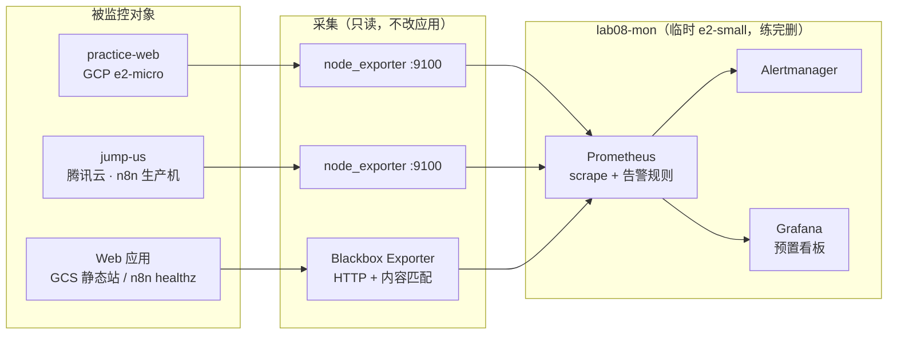

# 练习 8 · 混合云监控：一套 Prometheus + Grafana 同时看两台主机和 Web 应用

> 手敲版 runbook。2026-11-10 备料，环境为**干净起点**，所有步骤自己敲一遍。
> 主线：**自建** Prometheus + Grafana + Alertmanager + Blackbox Exporter，一张看板上同时有
> ① GCP 靶机 ② 腾讯云生产 n8n 主机 ③ 静态站 + n8n 的外部访问质量。
> 练完**一键归零**，不留过夜资源。

---

## 0. 这张练习练什么

练习 7 用的是 **GCP 自带**监控（Ops Agent → Cloud Monitoring）。练习 8 换成海外客户和 Upwork 上最常要的
**Prometheus + Grafana**，并且故意做成跨云：数据不落在任何一家的云监控里，而是统一进一个自建后台。

| 对照 | 练习 7（云厂商自带） | 练习 8（自建开源栈） |
| --- | --- | --- |
| 采集 | Ops Agent，只认自家 | Node Exporter，装哪台机器都行 |
| 后台 | Cloud Monitoring（托管） | Prometheus（自己跑） |
| 看板 | `gcloud monitoring dashboards` | Grafana（自动预置好） |
| 告警 | Alert Policy + 邮件通道 | `alerts.yml` 规则 + Alertmanager |
| 应用探活 | Uptime Check | Blackbox Exporter（含**内容校验**） |
| 混合云 | 非 GCE 机器内置指标被拒，要绕一圈 | 同一份 `prometheus.yml` 里两个 target，平级 |
| 清场 | 删云上资源 | 删一台临时 VM + 两个只读容器 |

### 架构



### 「Grafana 同时监控 Web 应用」具体指什么

Blackbox Exporter **从外面按真实用户的方式访问一次**，量四样东西：能不能连上（`probe_success`）、
状态码对不对（`probe_http_status_code`，必须 200）、**返回内容对不对**（`fail_if_body_not_matches_regexp`：
`lab08-health.txt` 整行必须是 `OK`、`n8n /healthz` 要含 `status:ok`）、以及响应时间（`probe_duration_seconds`）。

拨三个目标：GCS 静态站首页、练习专用的 `lab08-health.txt`、生产 n8n 的 `/healthz`（走 Cloudflare，
`cf-cache-status: DYNAMIC` 不缓存，能真实反映源站死活）。

所以看板上「主机」和「应用」是两套独立曲线：**主机挂了应用可能还活，应用挂了主机指标照样全绿** ——
这就是应用监控不能省的原因，也是破坏 ② 里「200 还在、内容错了」那条告警的用意。

> 不采应用内部指标（n8n 工作流执行数、请求量等）：那要开 `N8N_METRICS` 并重启容器，属于动生产机，
> 本练习不碰。下一轮想补，建议放到练习 9 的 Cloud Run 应用上做，别在生产 n8n 上试。

### 一个必须先知道的硬约束（实测）

`practice-web` 是 **e2-micro：总内存 969MB，可用只有 210MB**。Prometheus + Grafana 两个容器就要
500MB 以上，**塞不进去**（练习 7 里 Ops Agent 被慢 `dd` 拖垮，根子就是这台机器内存太紧）。

所以主线改成 **临时开一台 `lab08-mon`（e2-small / 2GB / Debian 12）专门跑监控栈**：
按小时计费，跑两小时几分钱，**练完立刻删**。这也更符合真实做法 —— 监控平面别和业务跑在同一台机器上，
否则业务一忙，监控自己先瞎，就是告警盲区。

> 不想开临时机器？看最后一节「备选：Grafana Cloud 免费层」，两条路只换后台，前面两台机器的采集不变。

### 安全边界（红线）

- 腾讯云 `jump-us` 是**生产机**：只装一个只读的 node_exporter 容器，**不碰 n8n 三容器、不改 Caddy、不碰任何配置**。
- 破坏演练**只针对 GCE 靶机和练习专用的 GCS 对象**，生产机全程只读观察。
- 9100 端口**必须**用云防火墙白名单限死来源 = 监控机公网 IP/32，绝不裸奔在公网。
- Grafana / Prometheus / Alertmanager 都只绑 `127.0.0.1`，靠 SSH 隧道看，不开公网端口。

---

## 1. 开工三件事（每个新终端窗口都要重敲）

```bash
cd ~/gcp-ops-labs/08-hybrid-prometheus-grafana
export PROJECT=lukechengtest ZONE=us-central1-a
export CLOUDSDK_CORE_DISABLE_PROMPTS=1
export http_proxy=http://127.0.0.1:7897 https_proxy=http://127.0.0.1:7897 \
       HTTP_PROXY=http://127.0.0.1:7897 HTTPS_PROXY=http://127.0.0.1:7897
G()   { gcloud "$@"; }
SSH() { ssh -i ~/.ssh/google_compute_engine -o StrictHostKeyChecking=no \
        -o UserKnownHostsFile=/dev/null -o ConnectTimeout=10 -o BatchMode=yes \
        lukecheng@35.194.5.128 "$@"; }
MON() { ssh -i ~/.ssh/google_compute_engine -o StrictHostKeyChecking=no \
        -o UserKnownHostsFile=/dev/null -o ConnectTimeout=10 -o BatchMode=yes \
        lukecheng@$MON_IP "$@"; }
```

> **这里特意不用 `gcloud compute ssh`**：这台 Mac 走 Clash 时它会卡死，`--plain` 又会问密码；
> 22 端口直连通，用 `~/.ssh/google_compute_engine` 密钥直连最稳（练习 7 的 `SSH()` 也是这么封装的）。
> `MON_IP` 在 S2 才有值，函数体是调用时才展开，所以先定义没问题；**新窗口要重新取一次 MON_IP**：
> `export MON_IP=$(G compute instances describe lab08-mon --zone=$ZONE --format='value(networkInterfaces[0].accessConfigs[0].natIP)')`
>
> 老坑：`G()` / `SSH()` / `MON()` / 各 IP 变量都是当前窗口临时的，**新开窗口不认**，
> 直接敲会报 `command not found: G` 或 `hostname contains invalid characters`。
> 代理是 Clash Verge 的 `7897`；`git` 全局还写着旧代理 `7890`，推送时用
> `git -c http.proxy=http://127.0.0.1:7897 push origin main`。

---

## 2. 手敲步骤

### S0 · 前置复核

```bash
# 练习 7 的 A11 清场应该已经跑完；这里只确认不打架
G monitoring dashboards list
G monitoring policies list

# 拿 GCE 靶机的内网 IP（同 VPC 内拉指标，不用配 VPC 防火墙）
export GCE_PRIVATE_IP=$(G compute instances describe practice-web --zone=$ZONE \
  --format='value(networkInterfaces[0].networkIP)')
export TENCENT_PUBLIC_IP=43.165.125.114
echo "GCE_PRIVATE_IP=$GCE_PRIVATE_IP  TENCENT_PUBLIC_IP=$TENCENT_PUBLIC_IP"

# 确认静态站首页对象（2026-11-10 实测 index.html 存在，模板里填的就是它）
G storage ls gs://lukecheng-static-site/
```

### S1 · 造 Web 应用探针对象

练习 8 用**自己的** `lab08-health.txt`，跟练习 7 的 `health.txt` 互不干扰，清场时各删各的。

```bash
printf 'OK\n' > /tmp/lab08-health.txt
G storage cp /tmp/lab08-health.txt gs://lukecheng-static-site/lab08-health.txt \
  --cache-control='no-store'
curl -sS --noproxy '*' -m 10 https://storage.googleapis.com/lukecheng-static-site/lab08-health.txt
curl -sS --noproxy '*' -m 10 https://cloudworkflowdone.com/healthz
```

期望：`OK` 和 `{"status":"ok"}`。后者走 Cloudflare，`cf-cache-status: DYNAMIC`，能真实反映源站死活。

### S2 · 开临时监控机

```bash
G compute instances create lab08-mon --zone=$ZONE \
  --machine-type=e2-small --image-family=debian-12 --image-project=debian-cloud \
  --boot-disk-size=20GB --tags=lab08-mon

export MON_IP=$(G compute instances describe lab08-mon --zone=$ZONE \
  --format='value(networkInterfaces[0].accessConfigs[0].natIP)')
echo "MON_IP=$MON_IP"     # 后面 MON() 函数和腾讯云白名单都要用，记下来
```

等 `STATUS: RUNNING` 再往下，且**新开窗口必须重新取一次 `MON_IP`**，否则 `MON()` 会拼出空地址报
`hostname contains invalid characters`（练习 7 踩过同款坑）。

### S3 · 装 Docker

```bash
MON 'curl -fsSL https://get.docker.com | sudo sh && sudo docker compose version'
```

> 用 `sudo docker compose`：脚本加的用户组要重新登录才生效，别在这卡住。

### S4 · 把材料传上监控机

直接用普通 scp（跟 `MON()` 一个道理，`gcloud compute scp` 在这台 Mac 上会卡）：

```bash
scp -r -i ~/.ssh/google_compute_engine -o StrictHostKeyChecking=no \
  -o UserKnownHostsFile=/dev/null ./ lukecheng@$MON_IP:~/lab08
MON 'ls -R ~/lab08 | head -30'
```

> 只有在不走代理的机器上才建议换成
> `gcloud compute scp --recurse . lab08-mon:~/lab08 --zone=$ZONE --project=$PROJECT`。

### S5 · 两台被管机装只读采集器

```bash
# GCE 靶机
SSH 'sudo docker run -d --name lab08-node-exporter --restart unless-stopped \
  --net=host --pid=host -v /:/host:ro,rslave \
  quay.io/prometheus/node-exporter:latest \
  --path.rootfs=/host --web.listen-address=:9100'

# 腾讯云生产机（root，不加 sudo；不动任何 n8n 容器）
ssh jump-us 'docker run -d --name lab08-node-exporter --restart unless-stopped \
  --net=host --pid=host -v /:/host:ro,rslave \
  quay.io/prometheus/node-exporter:latest \
  --path.rootfs=/host --web.listen-address=:9100'

# 两边各自验证
SSH        'curl -fsS -m 5 http://127.0.0.1:9100/metrics | head -3'
ssh jump-us 'curl -fsS -m 5 http://127.0.0.1:9100/metrics | head -3'
```

### S6 · 放行 9100（两步，性质完全不同）

**① 腾讯云：必须去控制台点**（轻量应用服务器的防火墙在云平台层，`firewalld` 是 inactive，命令行改没用）

> 控制台 → 轻量应用服务器 → `lhins-js6lgbt` → **防火墙** → 添加规则
> 协议 `TCP` / 端口 `9100` / 来源 **`$MON_IP/32`**（填 S2 记下的 IP）/ 策略 允许
>
> 用户习惯用截图找入口：在实例详情页左侧找「防火墙」页签，不是「安全组」。

**② GCP：不用配**。2026-11-10 实测 `default-allow-internal` 存在（`10.128.0.0/9`，TCP 全端口放行），
`practice-web` 内网 IP 是 `10.128.0.3`，配置里用 `GCE_PRIVATE_IP` 就能通。

从监控机上同时验证两条路：

```bash
MON "curl -fsS -m 8 http://$GCE_PRIVATE_IP:9100/metrics | head -3"
MON "curl -fsS -m 8 http://$TENCENT_PUBLIC_IP:9100/metrics | head -3"
```

两条都要吐出 `node_cpu_seconds_total` 之类才算通。**生产机那条不通，先查控制台白名单有没有填错 IP。**

### S7 · 渲染配置

模板里两个 IP 是占位符，`render.sh` 用 python3 替换（不依赖 `envsubst`）：

```bash
MON "cd ~/lab08 && GCE_PRIVATE_IP=$GCE_PRIVATE_IP TENCENT_PUBLIC_IP=$TENCENT_PUBLIC_IP bash scripts/render.sh"
MON 'cd ~/lab08 && grep -n "10\.\|43\.165" prometheus/prometheus.yml'
```

### S8 · 起栈

```bash
MON 'cd ~/lab08 && sudo docker compose up -d && sleep 5 && sudo docker compose ps'
```

首次拉 4 个镜像约 1~3 分钟。四个容器都要 `Up`（Prometheus、Grafana、Alertmanager、Blackbox）。

### S9 · 一键验全链路

```bash
MON 'cd ~/lab08 && bash scripts/check.sh'
```

这个脚本会打印四张表：容器状态、**所有 scrape target 的 UP/DOWN**、已加载的 6 条告警规则、当前 FIRING 告警。
期望：`node-gce` / `node-tencent` / `blackbox-http`(3) / `blackbox-content`(2) 全部 `up`，
`firing = 0`。**有 DOWN 先别往下走**，按最后一节翻车清单对。

### S10 · 看 Grafana（SSH 隧道，不开公网端口）

另开一个终端：

```bash
ssh -i ~/.ssh/google_compute_engine -o StrictHostKeyChecking=no \
  -o UserKnownHostsFile=/dev/null -N \
  -L 3000:127.0.0.1:3000 -L 9090:127.0.0.1:9090 -L 9093:127.0.0.1:9093 \
  lukecheng@$MON_IP
```

浏览器打开 `http://localhost:3000` → `admin` / `lab08admin` →
看板 **「Lab 08 · Hybrid hosts + Web apps」** 是自动预置好的，不用手动导入。

一张图上同时有：两台跨云主机的 CPU / 内存 / 根盘、5 个 Web 检查的可用性与响应时间、HTTP 状态码、
以及哪条告警正在响。另外 `http://localhost:9090/alerts` 是 Prometheus 的告警页，
`http://localhost:9093` 是 Alertmanager。

### S11 · 破坏 - 修复（三轮，只碰练习靶机和练习对象）

每轮：**破坏 → `MON 'cd ~/lab08 && bash scripts/check.sh'` 看 FIRING → Grafana 变红 → 修复 → 再看恢复**。

**① 主机掉线**

```bash
SSH 'sudo docker stop lab08-node-exporter'          # 等 1~2 分钟，HostDown 变 FIRING
SSH 'sudo docker start lab08-node-exporter'         # 等 1~2 分钟，恢复
```

**② 应用内容不对**

```bash
# 破坏值只能用 DOWN：BROKEN 第 3、4 个字母正好是 OK，子串匹配会误判「通过」（练习 7 实测踩过）
printf 'DOWN\n' > /tmp/lab08-health.txt
G storage cp /tmp/lab08-health.txt gs://lukecheng-static-site/lab08-health.txt --cache-control='no-store'
# 等 1~2 分钟：WebContentMismatch 亮起（http_2xx 那条仍然绿，因为 200 还在 —— 体会「状态码正常 ≠ 应用正常」）
printf 'OK\n' > /tmp/lab08-health.txt
G storage cp /tmp/lab08-health.txt gs://lukecheng-static-site/lab08-health.txt --cache-control='no-store'
```

**③ 应用整个没了**

```bash
G storage rm gs://lukecheng-static-site/lab08-health.txt
# 等 1~2 分钟：WebCheckFailed + WebContentMismatch 一起亮（404）
printf 'OK\n' > /tmp/lab08-health.txt
G storage cp /tmp/lab08-health.txt gs://lukecheng-static-site/lab08-health.txt --cache-control='no-store'
```

> 生产机 `jump-us` 全程不参与破坏。想看「某一朵云数据断了」的效果，可以只停 GCE 那台；
> 腾讯云那台的曲线在 Grafana 里保持不动，正好说明混合云里各链路是独立的。

### S12 · 可选：真收告警邮件

默认 `alertmanager.yml` 里是占位邮箱和 `CHANGE_ME`，**Alertmanager 能正常启动、正常收告警、正常显示恢复，
只是不发信**（发信失败日志可忽略）。练习不依赖邮件，UI 里就能看全部状态。

要真收信，填 163 的 **SMTP 授权码**（不是登录密码），重渲染并重启：

```bash
MON "cd ~/lab08 && GCE_PRIVATE_IP=$GCE_PRIVATE_IP TENCENT_PUBLIC_IP=$TENCENT_PUBLIC_IP \
  ALERT_EMAIL='csucxcc@163.com' SMTP_PASSWORD='你的授权码' bash scripts/render.sh"
MON 'cd ~/lab08 && sudo docker compose restart alertmanager'
```

再跑一遍 S11 任一破坏即可收触发信 + 恢复信。163 容易把告警信丢进垃圾箱，顺手加白名单。

---

## 3. 完整归零（练完必跑，别让机器过夜）

```bash
# ① 监控机：停栈 + 删 VM
MON 'cd ~/lab08 && sudo docker compose down -v'
G compute instances delete lab08-mon --zone=$ZONE --quiet

# ② 两台被管机：删只读采集器
SSH 'sudo docker rm -f lab08-node-exporter'
ssh jump-us 'docker rm -f lab08-node-exporter'

# ③ 腾讯云控制台：手动删掉 S6 加的那条 TCP 9100 规则（命令行删不掉云平台规则）

# ④ GCS 探针对象
G storage rm gs://lukecheng-static-site/lab08-health.txt

# ⑤ 本地渲染产物（模板保留，生成文件不进仓库）
rm -f prometheus/prometheus.yml alertmanager/alertmanager.yml /tmp/lab08-health.txt
```

归零复核清单：

```bash
G compute instances list --filter='name=lab08-mon'          # 期望空
SSH        'docker ps --filter name=lab08-node-exporter --format "{{.Names}}"'   # 期望空
ssh jump-us 'docker ps --filter name=lab08-node-exporter --format "{{.Names}}"'  # 期望空
ssh jump-us 'docker ps --format "{{.Names}} {{.Status}}"'  # n8n 三容器照常 Up
curl -sS --noproxy '*' -m 8 https://cloudworkflowdone.com/healthz   # {"status":"ok"}
G storage ls gs://lukecheng-static-site/ | grep lab08 || echo '练习 8 对象已清'
```

---

## 4. 最容易翻车的 14 条

| # | 现象 | 原因 / 修法 |
| --- | --- | --- |
| 1 | 想在 `practice-web` 上直接起栈，容器反复 OOM | **e2-micro 只有 210MB 可用内存**，跑不动。必须用临时 e2-small，或切到最后一节的 Grafana Cloud |
| 2 | 新窗口 `command not found: G` / `hostname contains invalid characters` | 函数和 IP 变量是窗口临时的，重敲「开工三件事」整段 |
| 3 | `gcloud compute ssh` / `scp` 卡死 | 这台 Mac 走 Clash 时 gcloud 的 SSH 通道不通；`MON()` 和 S4 **已统一改成** `ssh -i ~/.ssh/google_compute_engine` 直连，别改回去 |
| 4 | `docker compose` 报权限 | 脚本加的 docker 组要重新登录才生效，统一用 `sudo docker compose` |
| 5 | `node-tencent` 一直 DOWN，本机 curl 却通 | 腾讯云轻量防火墙在**控制台**，不是 `firewall-cmd`；白名单源必须填 `$MON_IP/32` |
| 6 | `node-gce` DOWN | 用**内网 IP**；写成公网 IP 反而要额外配 VPC 防火墙 |
| 7 | `blackbox-*` DOWN 或拨到自己 | relabel 三段缺一不可：`__address__` → `__param_target` → `instance` → `blackbox:9115` |
| 8 | 内容改坏了却不告警 | ① **`BROKEN` 含 `OK` 子串**，别用它，改 `DOWN`（练习 7 同款坑，正则已加严成 `(?m)^OK$`）；② GCS 边缘缓存，上传必须带 `--cache-control='no-store'` 并等 1~2 个 30s 周期 |
| 9 | 首页 target 一直 404 | 先 `G storage ls gs://lukecheng-static-site/` 看真实对象名，改模板里 `index.html` 那行 |
| 10 | 和练习 7 互相清掉对方的对象 | 练习 8 专用 `lab08-health.txt`，练习 7 用 `health.txt` |
| 11 | 告警 `HostDown` 里没有 `host` 标签 | `static_configs` 的 `labels` 才是 target 标签来源，别只写在 `relabel_configs` |
| 12 | Alertmanager 日志刷 SMTP 报错 | 默认占位值发不出信是**预期行为**，不影响告警状态；填授权码见 S12 |
| 13 | 想在生产机上做破坏演练 | 红线：只装只读采集器，不碰 n8n 三容器 / Caddy / 任何配置 |
| 14 | `lab08-mon` 忘删 | e2-small 按小时计费，练完立刻删；归零清单第 ① 步 |

---

## 5. 备选：Grafana Cloud 免费层（不想开临时 VM）

思路一样，只是把「自建 Prometheus + Grafana」换成托管后台，两侧改成**主动推送**，
好处是**两台被管机都不用开任何入站端口**，生产机最安全：

1. 注册 Grafana Cloud 免费账号，拿到 Prometheus `remote_write` URL + API key。
2. 两台机器各跑一个 **Grafana Alloy**（一个进程搞定采集 + 推送），最小配置：

```hcl
prometheus.exporter.node "host" { }

prometheus.scrape "host" {
  targets    = prometheus.exporter.node.host.targets
  forward_to = [prometheus.remote_write.cloud.receiver]
  job_name   = "node"
}

prometheus.remote_write "cloud" {
  endpoint {
    url = "https://prometheus-...grafana.net/api/prom/push"
    basic_auth { username = "..."  password = "..." }
  }
}
```

3. Web 应用：要么继续用本练习的 `blackbox.yml` 加 `prometheus.exporter.blackbox`，
   要么直接用 Grafana Cloud 自带的 Synthetic Monitoring（免费额度）。
4. 看板仍可用本目录的 `grafana/dashboards/hybrid-overview.json` 导入（数据源 uid 改成 Cloud 的）。

**取舍**：这条路零入站端口、零运维，但多一次注册、PromQL 规则要搬到 Cloud 侧，
「自己搭过一整套」的作品集成色不如主线。**主线练完再切这个，两边都会。**

---

## 6. Portfolio summary (EN)

> **Hybrid-cloud monitoring with Prometheus & Grafana.** Built a self-hosted observability stack on a
> temporary GCE instance, scraping `node_exporter` from both a GCP VM and a production n8n host on
> Tencent Cloud (read-only, firewall-restricted to the collector IP), plus Blackbox Exporter probes
> against a GCS static site and the n8n health endpoint with body-content assertions. Provisioned
> Grafana datasource and dashboard as code, wrote six PromQL alerting rules (host down, disk, memory,
> probe failure, content mismatch, latency), and ran three break-fix drills. Learned the hard way that
> a 1 GB lab VM cannot host the monitoring plane — the collector must be isolated from the workload
> it watches, or the monitoring goes blind exactly when the incident happens. All resources torn down.

**简历 / 提案关键词**：`Prometheus` · `Grafana` · `Alertmanager` · `Blackbox Exporter` ·
`node_exporter` · `PromQL` · `dashboard as code` · `hybrid cloud` · `multi-cloud` ·
`synthetic monitoring` · `alert fatigue` · `OpenTelemetry`（下一轮可把采集层换成 OTel Collector）

---

## 7. 文件清单

| 文件 | 作用 |
| --- | --- |
| `docker-compose.yml` | 四个容器；所有 UI 端口只绑 `127.0.0.1` |
| `prometheus/prometheus.yml.template` | 2 个主机 job + 2 个 Web 拨测 job；IP 占位符由 `render.sh` 填 |
| `prometheus/alerts.yml` | 6 条告警规则，主机层 3 条 + 应用层 3 条 |
| `blackbox/blackbox.yml` | `http_2xx` 与 `http_body_ok` 两个探测模块 |
| `alertmanager/alertmanager.yml.template` | 通知路由；默认占位，可选填 163 授权码 |
| `grafana/provisioning/*` | 数据源 + 看板自动加载，不用手动点 |
| `grafana/dashboards/hybrid-overview.json` | 一张图看两台主机 + 5 个 Web 检查 + 告警状态 |
| `scripts/render.sh` | 把模板里的 IP / 邮箱占位符换成真实值 |
| `scripts/check.sh` | 一键打印容器 / targets / 规则 / FIRING 告警 |

> `.gitignore` 已排除渲染产物 `prometheus/prometheus.yml` 和 `alertmanager/alertmanager.yml`，仓库里不含任何密钥。
